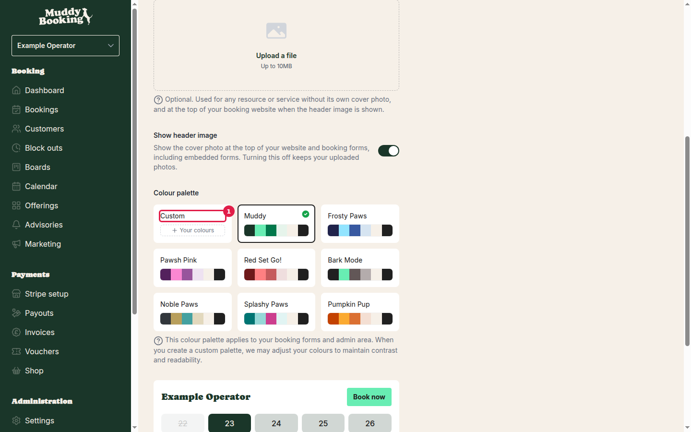

## Accessing the colour scheme settings

The colour scheme sets the colours of your booking forms and your admin area. To change it:

1. Click **Settings** in the left-hand menu
2. In the Business section, click **Branding** **(1)**

## Selecting your colour scheme

On the Branding settings page, scroll down to the **Colour palette** section **(1)**. You'll see a row of small tiles to pick from.

There are eight preset schemes and one **Custom** option. Custom is always shown first:

- **Muddy**: the original Muddy Booking colours
- **Frosty Paws**: cool, icy tones
- **Pawsh Pink**: warm pinks
- **Red Set Go!**: bold reds
- **Pumpkin Pup**: autumn oranges
- **Bark Mode**: dark tones
- **Noble Paws**: muted and elegant
- **Splashy Paws**: fresh and bright

Click any tile to select it. A live preview of a sample booking page updates on the right so you can see how the colours look straight away.

## Building a custom palette

If none of the preset schemes match your brand, choose **Custom** to pick your own colours.

Two colour pickers appear:

- **Brand colour** **(1)**: your main brand colour. This sets the primary buttons, headings, and key elements on your booking pages.
- **Accent colour** **(2)**: a supporting colour used for highlights and secondary elements.

For each colour you can:
- Click a swatch to open the picker and drag to choose a shade
- Use the hue slider to shift the colour
- Click the eyedropper to pick a colour from anywhere on your screen
- Type a specific hex or RGB value

### Getting colours from your logo **(3)**

If you've uploaded a logo, Muddy analyses it and suggests swatches taken from it. Click any suggested swatch to use it as your brand or accent colour. This is a quick way to match your palette to your existing brand.

If you haven't uploaded a logo yet, you'll see a prompt to upload one first. See [Customizing branding and website](customizing-branding-and-website.md#uploading-your-logo) for how to do that.

> Muddy may fine-tune your chosen colours slightly to make sure text stays readable against buttons and backgrounds.

## Saving your changes

Click **Save** at the bottom of the page.

The new colours apply straight away to:

- Your admin area
- Your booking forms
- Any other Muddy pages your customers visit

The scheme applies across your whole account, not to a single walk. You can change it as often as you like.
