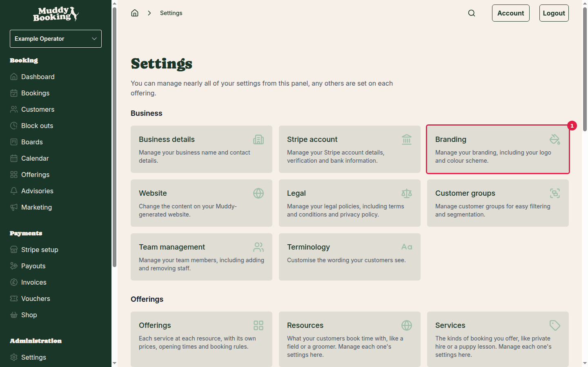
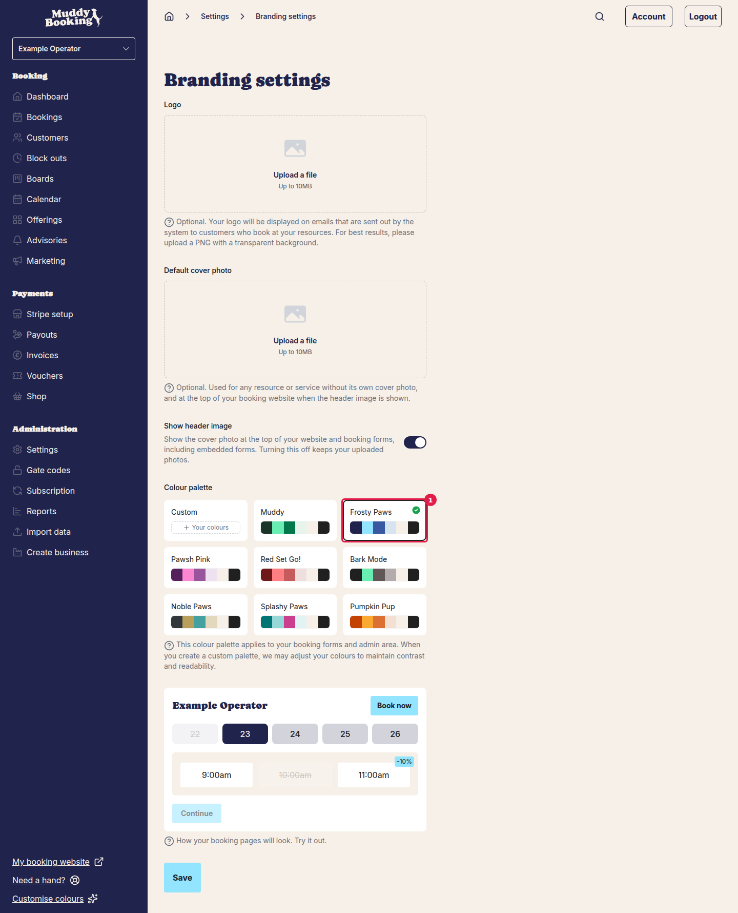
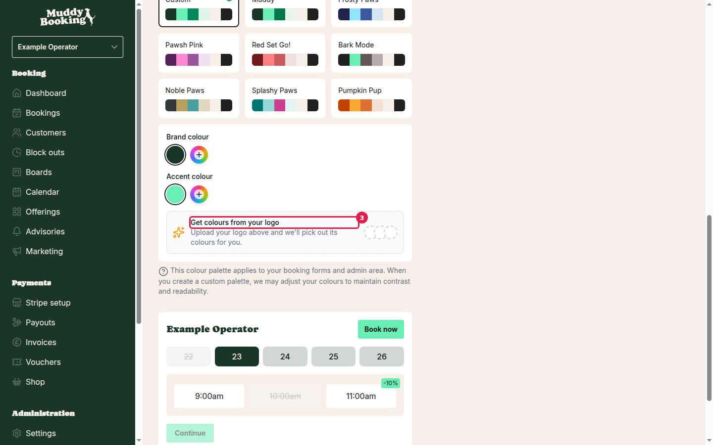

## Accessing the colour scheme settings

The colour scheme sets the colours of your booking forms and your admin area. To change it:

1. Click **Settings** in the left-hand menu
2. In the Business section, click **Branding** **(1)**

## Selecting your colour scheme

On the [Branding settings page](customizing-branding-and-website.md#customizing-your-branding), the **Colour palette** section shows your palettes as small tiles. **Custom** comes first, followed by eight ready-made schemes. Click a tile to select it. A sample of your booking page under the palettes shows the new colours straight away, so you can try a few before you save.

The tile labelled **Frosty Paws** **(1)** is selected here. The available schemes are:

- **Muddy**: the original Muddy Booking colours
- **Frosty Paws**: cool, icy tones
- **Pawsh Pink**: pink
- **Red Set Go!**: bold red
- **Pumpkin Pup**: autumn orange
- **Bark Mode**: dark
- **Noble Paws**: muted and elegant
- **Splashy Paws**: teal and pink

## Building a custom palette

If none of the schemes match your brand, click **Custom** and choose two colours:

- **Brand colour**: your main colour
- **Accent colour**: a second colour for highlights

For each one, click a swatch, or click the rainbow **+** button to choose any colour.

If you've uploaded a logo, Muddy picks out its colours and shows them as swatches. A new custom palette starts from your logo's two main colours. If you haven't uploaded one yet, **Get colours from your logo** **(3)** reminds you to [upload your logo](customizing-branding-and-website.md#uploading-your-logo) first.

Muddy may adjust your colours slightly so that text stays easy to read.

## Saving your changes

Click **Save** at the bottom of the page.

The new colours apply straight away to:

- Your admin area
- Your booking forms
- Any other Muddy pages your customers visit

## Important notes

- The scheme applies across your whole account, not to a single walk
- You can change it as often as you like
