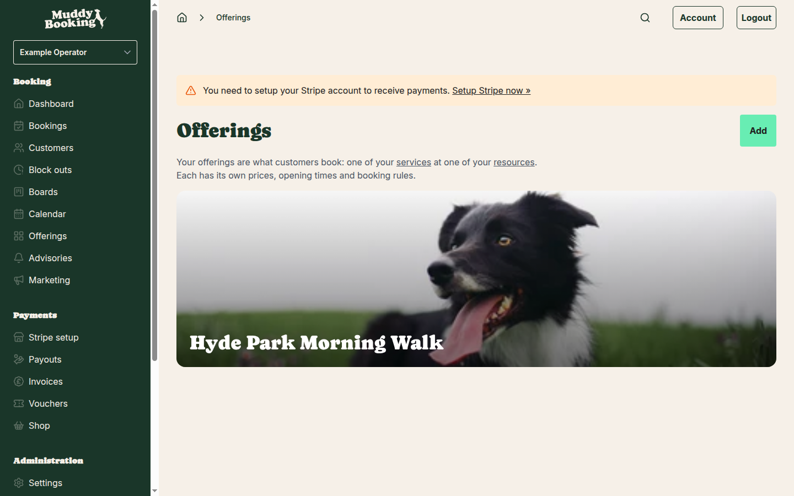
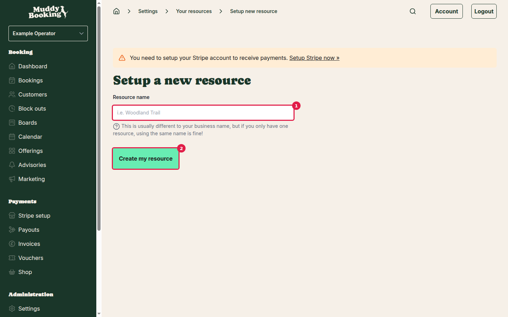
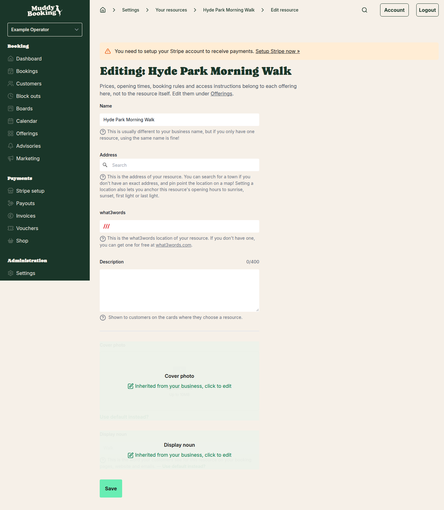
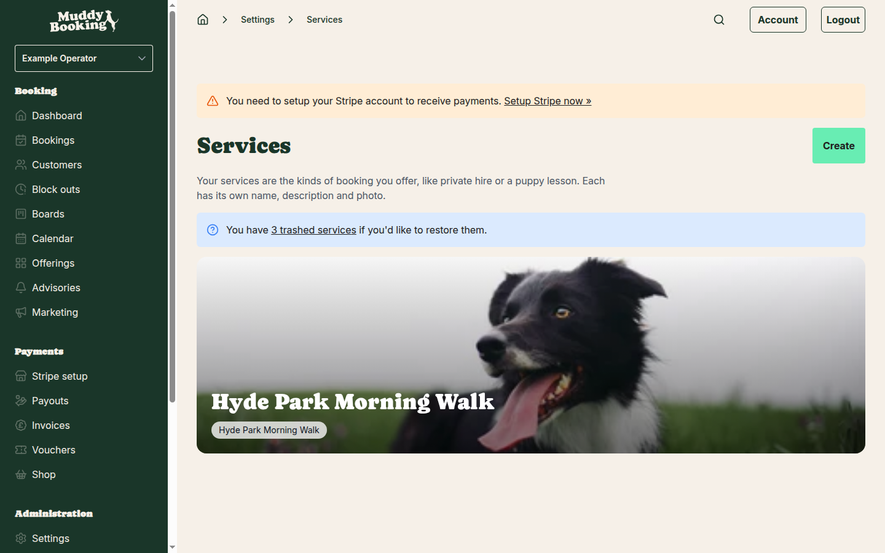
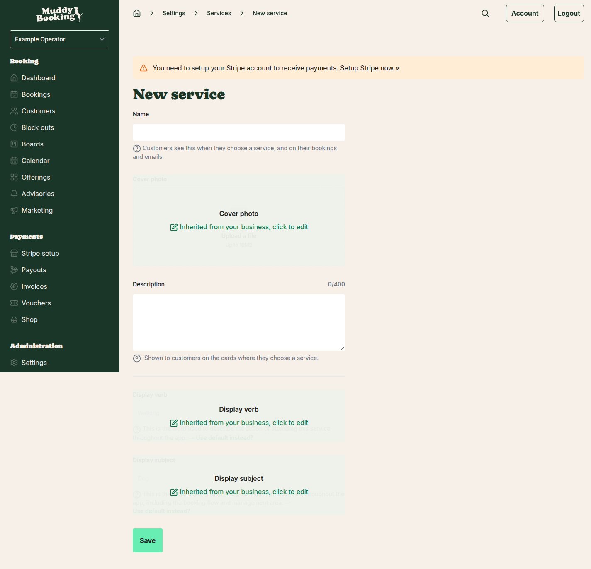
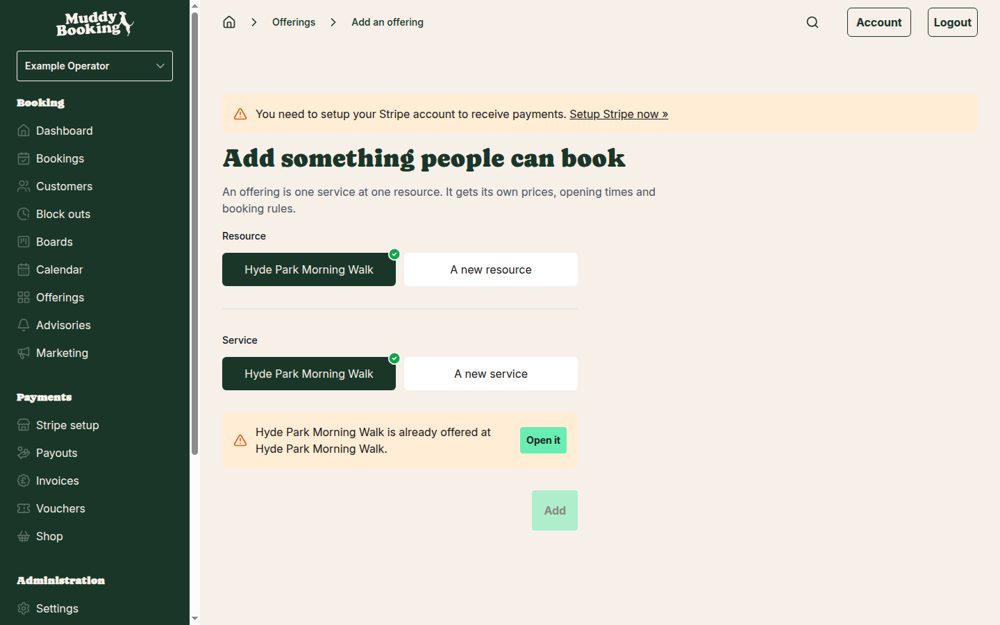
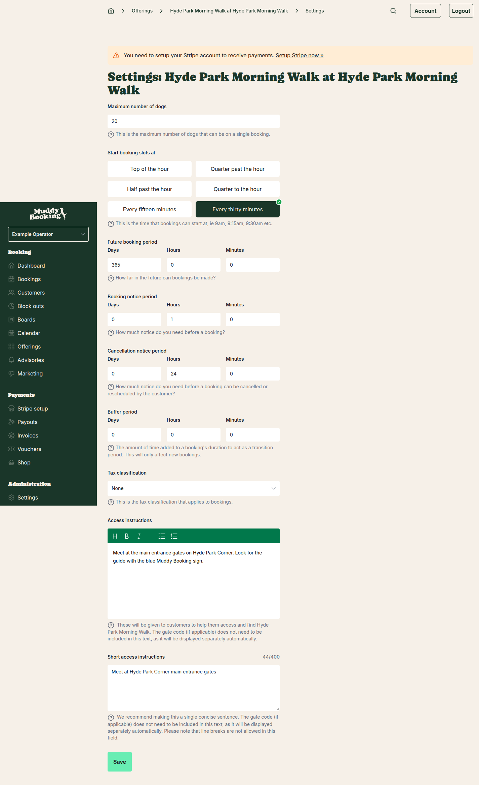
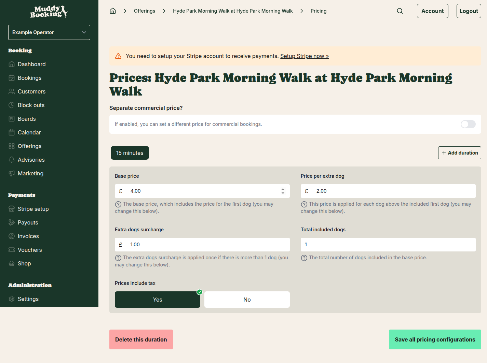
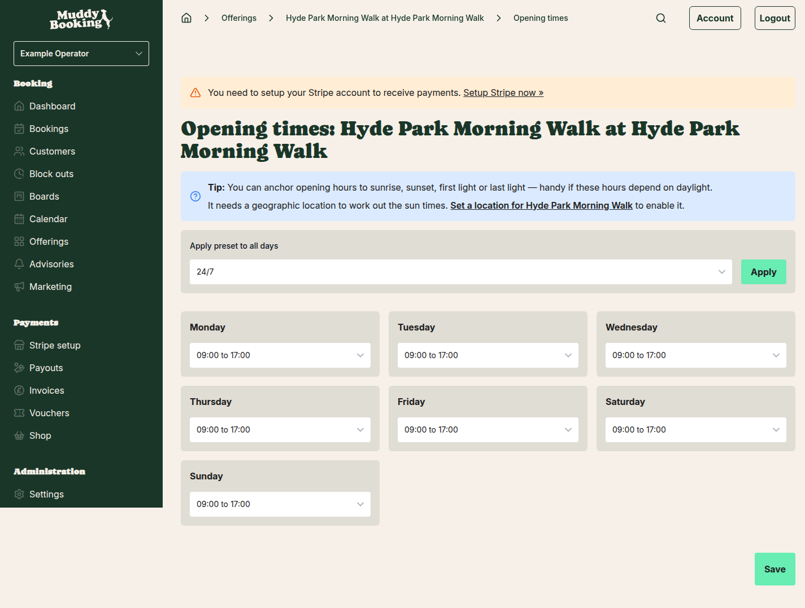
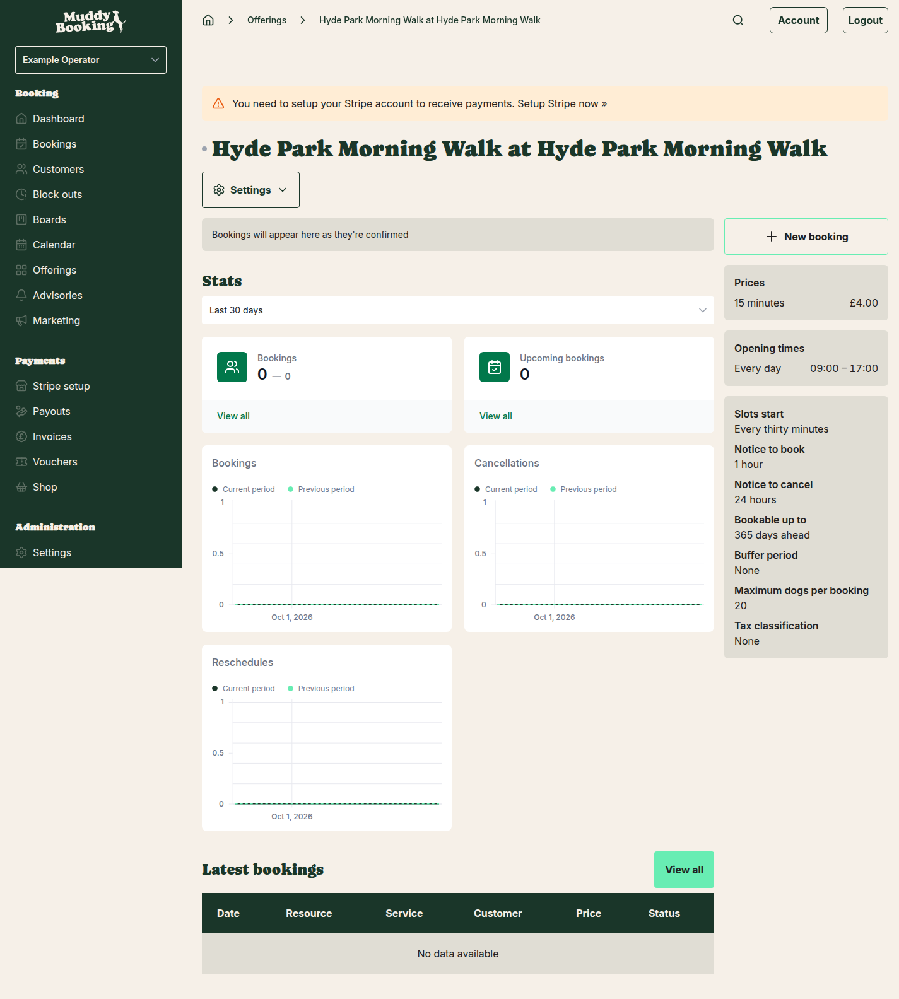

## How offerings work

Muddy Booking organises what customers can book around three things:

- **Resources**: the places or people customers book time with, like a park, a field, or a groomer.
- **Services**: the types of booking you offer, like a group walk, a private hire, or a puppy session.
- **Offerings**: a specific service at a specific resource. Each offering gets its own prices, opening times and booking rules.

For example, if you run group walks and private hires at two different parks, you would have two resources and two services. That gives you up to four offerings, one for each combination. If you only do one type of walk at one location, you will have one resource, one service, and one offering.

Go to **Offerings** in the left-hand menu to get started.

## Step 1: Create a resource

A resource is the place or person being booked. Click **Offerings** in the left-hand menu, then click the **resources** link in the description text, or go directly to **Resources** from the Offerings area.

Click **Add resource** **(1)**.

Give the resource a **Name** **(1)** and click **Create my resource** **(2)**. If you only have one walk location, the name can match your business name.

Once created, click **Settings** on the resource to fill in the details.

### Resource settings

- **Name**: what customers see when they choose where to book.
- **Address**: where the resource is. Search for a town name if you don't have an exact address, and pin the spot on the map. Setting an address also lets you anchor opening times to sunrise or sunset.
- **what3words**: a precise location customers can use to find you. Get one free at what3words.com.
- **Description**: a short summary (up to 400 characters) shown on the booking page so customers know what to expect.
- **Cover photo**: a photo of this resource, up to 10 MB. If you leave this blank it will use your business cover photo.
- **Display noun**: the word customers see for this resource, for example "field" or "park". Inherits from your business settings unless you change it here.

Click **Save** when you are done.

> Prices, opening times, booking rules and access instructions are set on the offering, not on the resource itself. You do not need to add those here.

## Step 2: Create a service

A service is the type of booking you offer. Click the **services** link from the Offerings page, or go directly to **Services**.

Click **Create**.

### Service settings

- **Name**: what customers see when they choose a service, and what appears on their booking confirmation and emails. For example "Group walk" or "Private hire".
- **Cover photo**: a photo that represents this service, up to 10 MB. Falls back to your business photo if not set.
- **Description**: up to 400 characters shown to customers on the service selection cards.
- **Display verb**: the action word used throughout the app and booking flow, for example "Walking". Inherits from your business settings. Untick **Use default instead?** to set a different word for this service.
- **Display subject**: what is being booked, for example "Dog". Inherits from your business settings. Untick **Use default instead?** to set a different word here.

Click **Save** when you are done.

## Step 3: Create an offering

An offering links one service to one resource, and is what customers actually book. Go to **Offerings** and click **Add**.

Choose the **Resource** and **Service** from the menus. You can also choose **A new resource** or **A new service** to create one inline without leaving the page.

If that combination already exists, the page will tell you and offer a link to open it instead.

Click **Add** to create the offering.

## Step 4: Configure offering settings

After creating an offering, click **Settings** on its overview page to set the booking rules.

- **Maximum number of dogs**: the most dogs allowed on a single booking.
- **Start booking slots at**: when bookings can begin. Choose from the top of the hour, quarter past, half past, quarter to, every 15 minutes, or every 30 minutes.
- **Future booking period**: how far in advance customers can book. Enter a number of days, hours or minutes.
- **Booking notice period**: how much notice you need before a booking. Customers cannot book sooner than this.
- **Cancellation notice period**: how much notice a customer must give to cancel or reschedule their booking.
- **Buffer period**: extra time added after each booking as a transition period. Only affects new bookings, not existing ones.
- **Tax classification**: choose None, or the VAT rate that applies to your bookings.
- **Access instructions**: directions to help customers find you and get in. Gate codes are shown to customers separately, so you do not need to include them here.
- **Short access instructions**: a single sentence version, up to 400 characters, with no line breaks. Used in places where space is limited.

Click **Save** when you are done.

## Step 5: Set pricing

Click **Pricing** from the offering overview to set your prices. Each offering has its own pricing, so you can charge differently for different services or locations.

Pricing is organised by booking duration. You will see a tab for each duration you offer, such as "15 minutes" or "1 hour". Click **Add duration** to add more.

For each duration, set:

- **Base price**: the starting price, which includes the first dog. Enter the amount in pounds.
- **Price per extra dog**: added for each dog beyond the number included in the base price.
- **Extra dogs surcharge**: a one-off surcharge applied when there is more than one dog, instead of a per-dog rate. Use this if you want a flat extra charge rather than a per-dog amount.
- **Total included dogs**: how many dogs are covered by the base price before the per-extra-dog or surcharge pricing kicks in.
- **Prices include tax**: choose **Yes** if the prices you enter already include VAT, or **No** if tax should be added on top.

You can also switch on **Separate commercial price?** if you want to charge a different rate for commercial bookings.

Click **Save all pricing configurations** when you are done.

To remove a duration you no longer offer, click **Delete this duration** at the bottom of that tab.

## Step 6: Set opening times

Click **Opening times** from the offering overview to set when this offering is available for booking.

You can apply the same hours to every day at once using **Apply preset to all days**, then click **Apply**. Or set each day individually using the menu next to Monday, Tuesday, and so on. Preset options include common ranges like 09:00 to 17:00, 06:00 to 20:00, 24/7, **Closed**, or **Custom** if you need specific times.

> If your hours follow daylight (for example, you always walk at sunrise or before dusk), set a location on your resource first. The offering's opening times page will then let you anchor times to sunrise, sunset, first light, or last light rather than fixed clock times.

Click **Save** after making changes.

## Activating your offering

Once you have set up pricing and opening times, your offering will be marked as **Active** and customers will be able to book it. If something is missing, such as pricing not being configured, the offering will show as **Inactive** and will not appear to customers.

The offering overview page shows a summary of your configuration, including prices, opening times, slot intervals, notice periods, and maximum dogs, so you can see everything at a glance.

