## How offerings work

Muddy Booking organises what customers can book around three things:

- **Resources**: the places customers book, like a field, a paddock, or a pool.
- **Services**: the types of booking you offer, like private hire, a training session, or a hydrotherapy swim.
- **Offerings**: a specific service at a specific resource. Each offering gets its own prices, opening times and booking rules.

For example, if you offer private hire and training sessions at two different fields, you would have two resources and two services. That gives you up to four offerings, one for each combination. If you only offer one kind of booking at one place, you will have one resource, one service, and one offering.

Go to **Offerings** in the left-hand menu to get started.

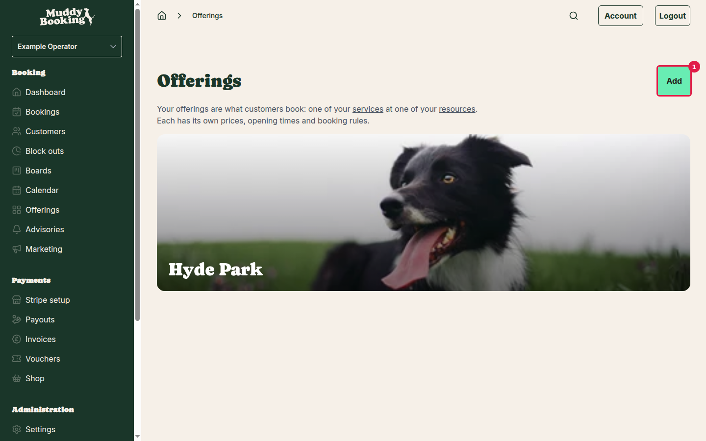

## Step 1: Create a resource

A resource is the place or person being booked. Click **Offerings** in the left-hand menu, then click the **resources** link in the description text, or go directly to **Resources** from the Offerings area.

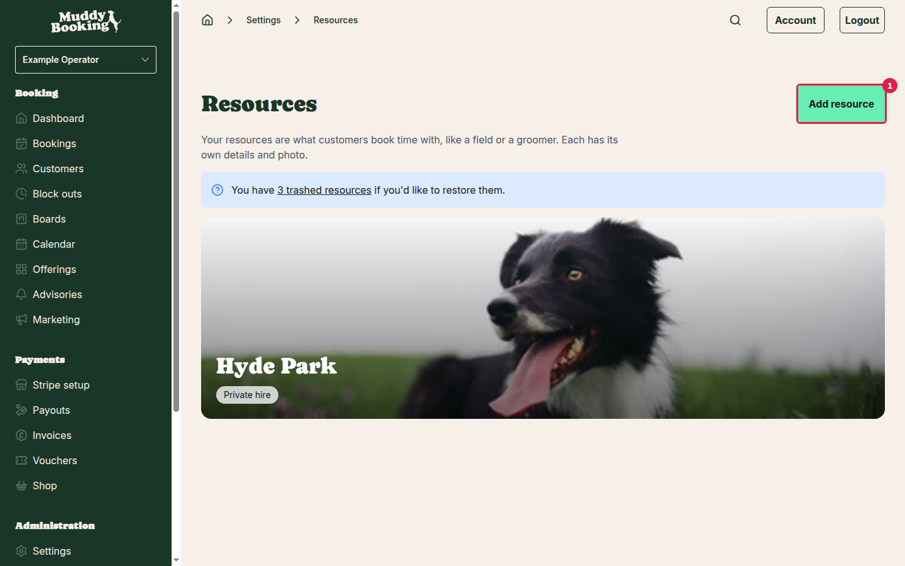

Click **Add resource** **(1)**.

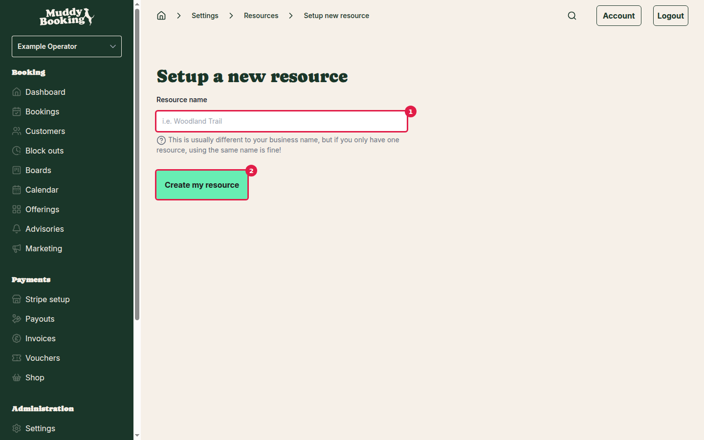

Give the resource a **Resource name** **(1)** and click **Create my resource** **(2)**. If you only have one walk location, the name can match your business name.

Once created, click **Settings** on the resource to fill in the details.

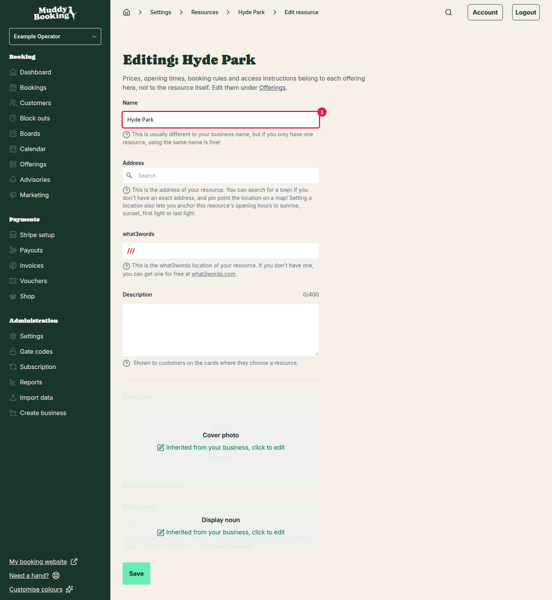

### Resource settings

- **Name**: what customers see when they choose where to book.
- **Address**: where the resource is. Search for a town name if you don't have an exact address, and pin the spot on the map. Setting an address also lets you anchor opening times to sunrise or sunset.
- **what3words**: a precise location customers can use to find you. Get one free at what3words.com.
- **Description**: a short summary (up to 400 characters) shown on the cards where customers choose a resource.
- **Cover photo**: a photo of this resource, up to 10 MB. If you leave this blank it will use your business cover photo.
- **Display noun**: the word customers see for this resource, for example "field" or "park". Inherits from your business settings unless you change it here.

Click **Save** when you are done.

> Prices, opening times, booking rules and access instructions are set on the offering, not on the resource itself. You do not need to add those here.

## Step 2: Create a service

A service is the type of booking you offer. Click the **services** link from the Offerings page, or go directly to **Services**.

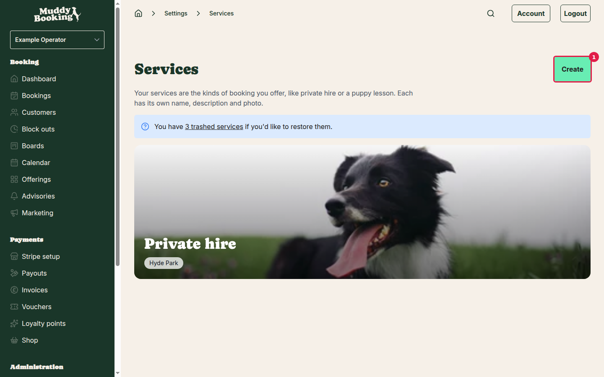

Click **Create** **(1)**.

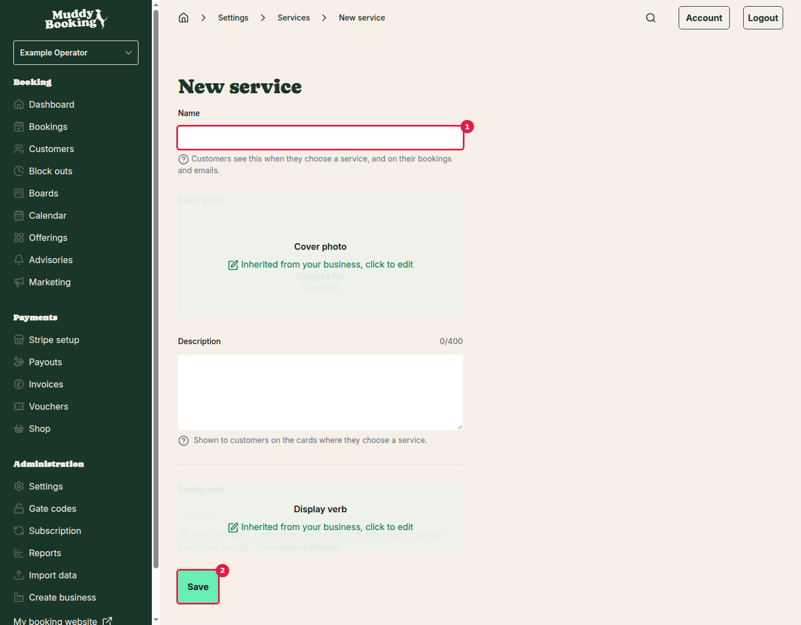

### Service settings

- **Name**: what customers see when they choose a service, and what appears on their booking confirmation and emails. For example "Private hire" or "Training session".
- **Cover photo**: a photo that represents this service, up to 10 MB. Falls back to your business photo if not set.
- **Description**: up to 400 characters shown to customers on the service selection cards.
- **Display verb**: the action word used throughout the app and booking flow, for example "Walking". Inherits from your business settings. Type a different word to override it for this service. Click **Use default instead?** to go back to the business default.

Click **Save** **(2)** when you are done.

## Step 3: Create an offering

An offering links one service to one resource, and is what customers actually book. Go to **Offerings** and click **Add**.

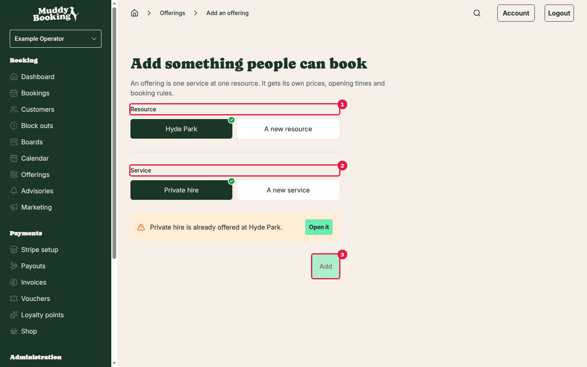

Choose the **Resource** **(1)** and **Service** **(2)** from the menus. You can also choose **A new resource** or **A new service** to create one inline without leaving the page.

If that combination already exists, the page will tell you and offer a link to open it instead.

Under **Start it from**, choose **Start blank**, or pick one of your other offerings to copy. A copy brings over its prices, opening times, booking rules, buffer, tax classification and access instructions, so check the access instructions afterwards if you copy from another resource.

Click **Add** **(3)** to create the offering.

## Step 4: Configure offering settings

After creating an offering, click **Settings** on its overview page, then click **Settings** ("Booking rules, tax and access instructions") in the menu that appears.

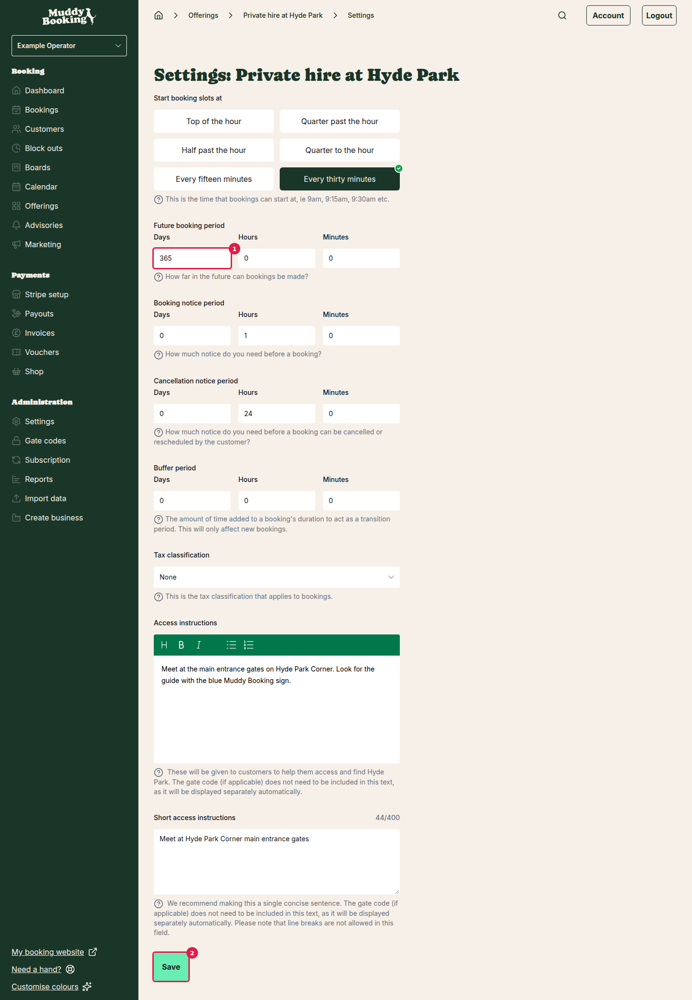

- **Future booking period** **(1)**: how far in advance customers can book. Enter a number of days, hours or minutes.
- **Booking notice period**: how much notice you need before a booking. Customers cannot book sooner than this.
- **Cancellation notice period**: how much notice a customer must give to cancel or reschedule their booking.
- **Buffer period**: extra time added after each booking as a transition period. Only affects new bookings, not existing ones.
- **Tax classification**: choose None, or the VAT rate that applies to your bookings.
- **Access instructions**: directions to help customers find you and get in. Gate codes are shown to customers separately, so you do not need to include them here.
- **Short access instructions**: a single sentence version, up to 400 characters, with no line breaks. Used in places where space is limited.

Click **Save** **(2)** when you are done.

## Step 5: Set prices

Click **Settings** on the offering overview, then click **Prices** ("Durations, prices and questions"). Each offering has its own prices, so you can charge differently for different services or locations.

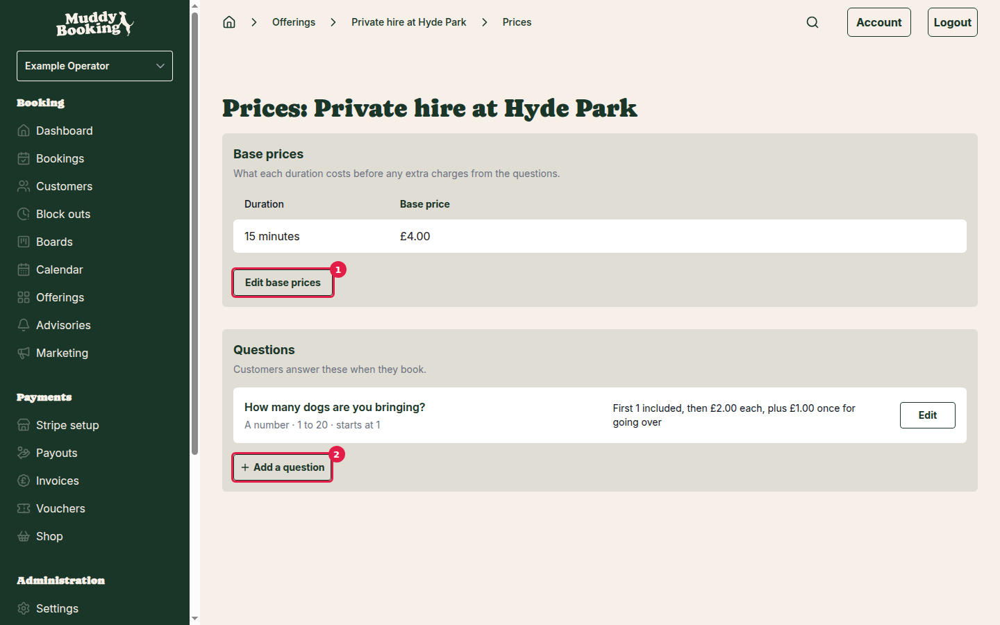

Click **Edit base prices** **(1)** to add the durations customers can book, such as 30 or 60 minutes, and what each one costs. Customers can't book the offering until it has at least one duration.

Under **Questions**, click **Add a question** **(2)** to add questions customers answer when they book, such as how many dogs they're bringing. Answers can add charges, limit how many can come, or pick a different set of prices. A new business starts with no questions, so customers just pay the base price of the duration they pick.

For the full guide, see [Setting up prices and questions](setting-up-prices-and-questions.md).

## Step 6: Set opening times

Click **Settings** on the offering overview, then click **Opening times** to set when this offering is available for booking.

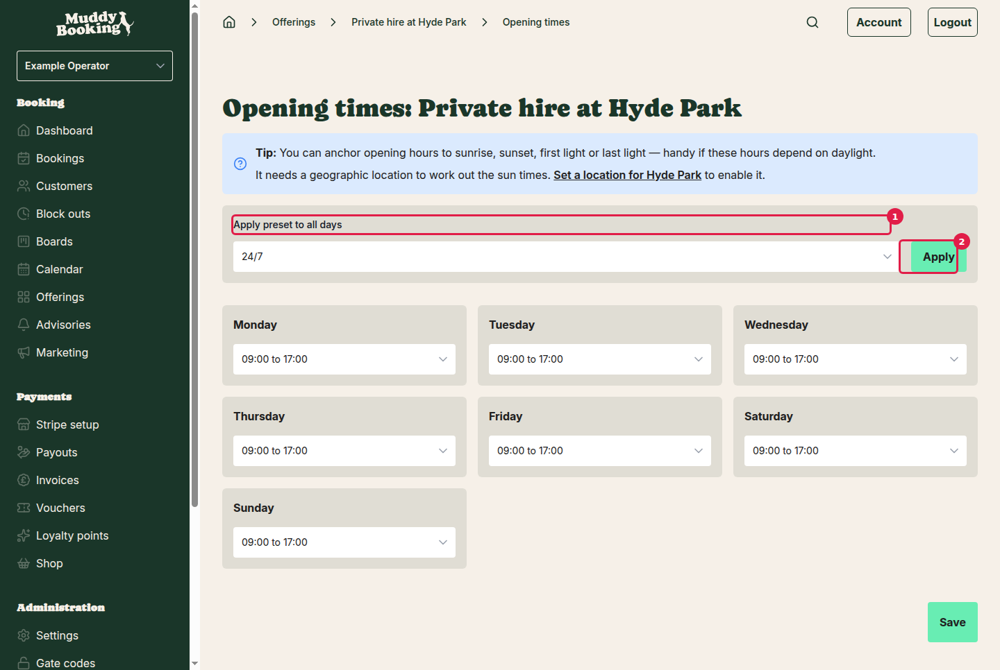

You can apply the same hours to every day at once using **Apply preset to all days** **(1)**, then click **Apply** **(2)**. Or set each day individually using the menu next to Monday, Tuesday, and so on. Preset options include common ranges like 09:00 to 17:00, 06:00 to 20:00, 24/7, **Closed**, or **Custom** if you need specific times.

At the top of the page, **Start booking slots at** sets when bookings can begin, such as on the hour or every fifteen minutes. Each day can change it. See [Choosing when bookings start](setting-up-opening-times.md#choosing-when-bookings-start).

> If your hours follow daylight (for example, you always walk at sunrise or before dusk), set a location on your resource first. The offering's opening times page will then let you anchor times to sunrise, sunset, first light, or last light rather than fixed clock times.

Click **Save** after making changes.

## Activating your offering

Customers can book an offering once it has prices and opening times. Until then, its overview page shows a warning with buttons to **Add prices** or **Set opening times**. If its opening times use sunrise or sunset, the resource also needs a location before customers can book.

The offering overview page shows a summary of your configuration, including prices, opening times, when slots start, notice periods, buffer period and tax classification, so you can see everything at a glance.

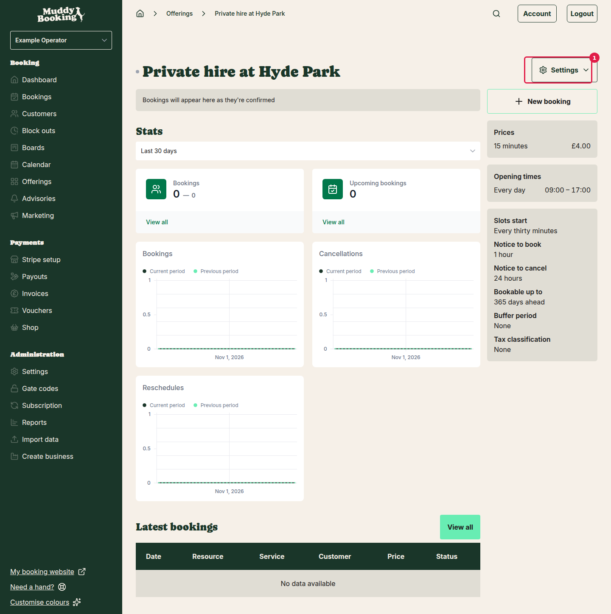
