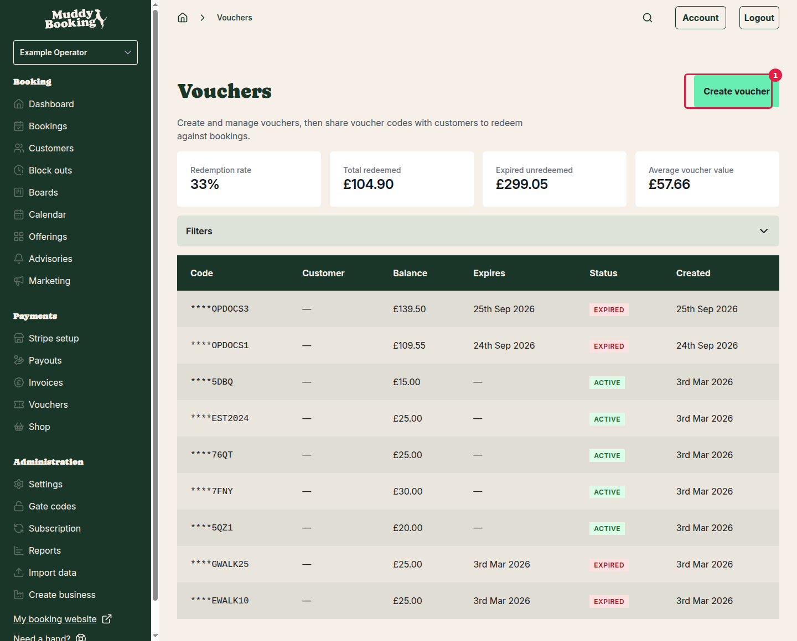
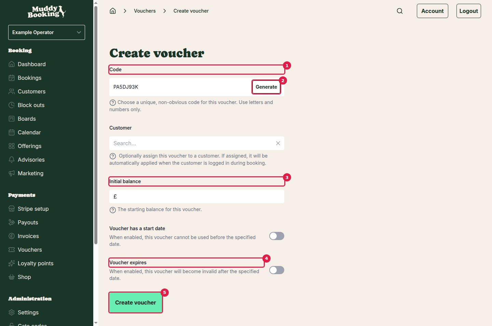
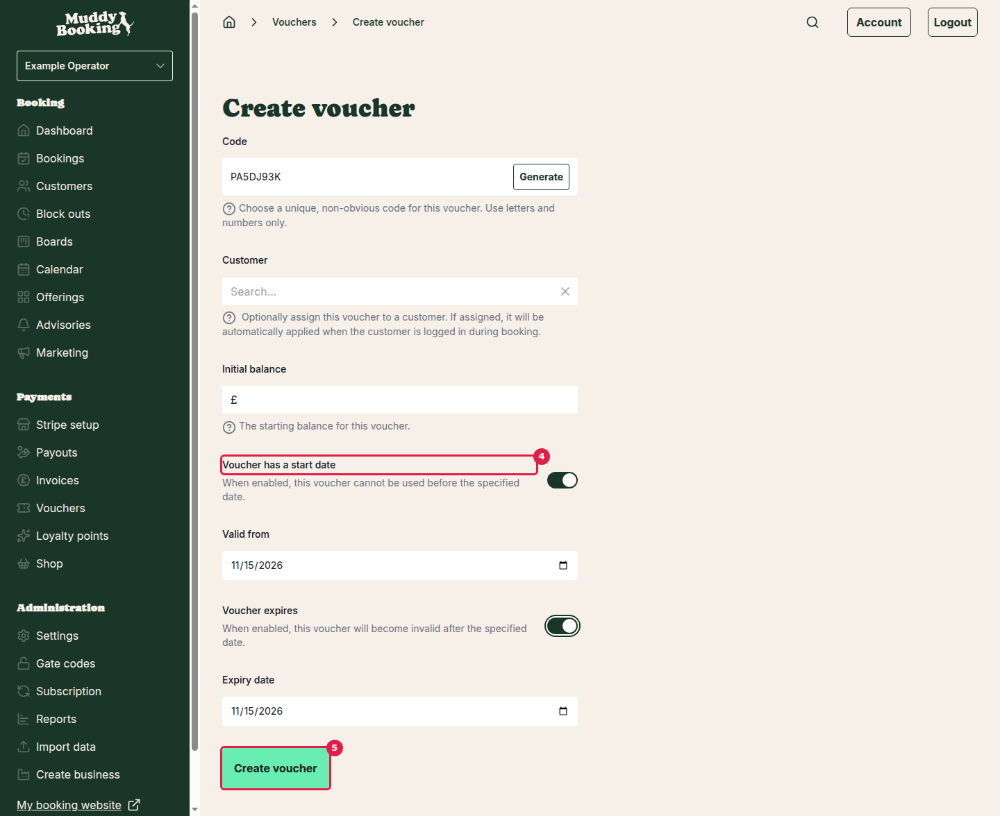
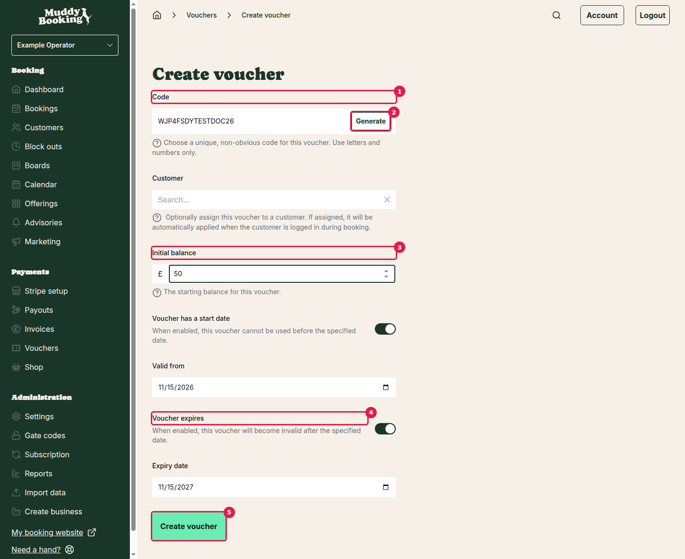
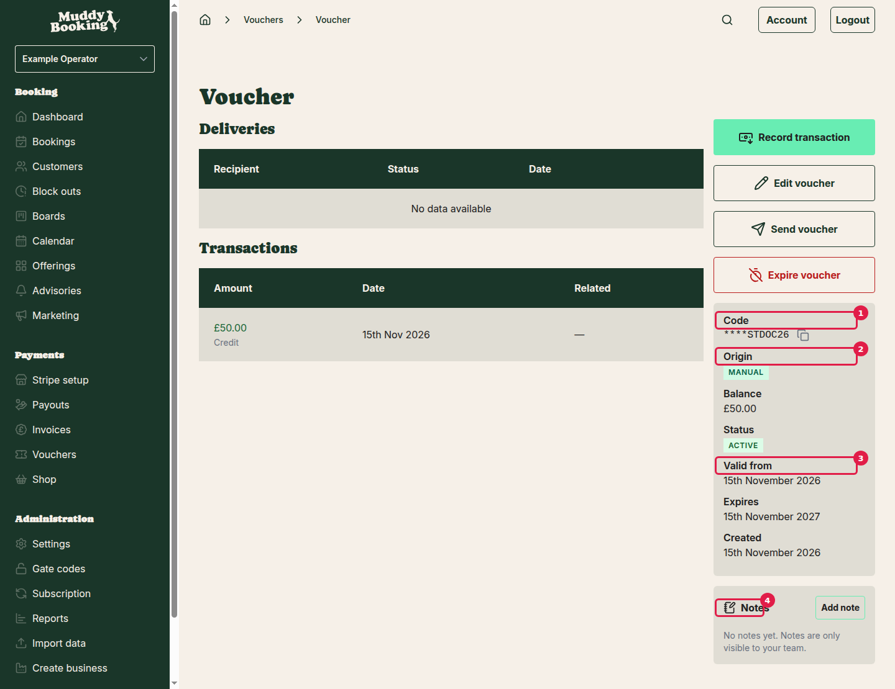
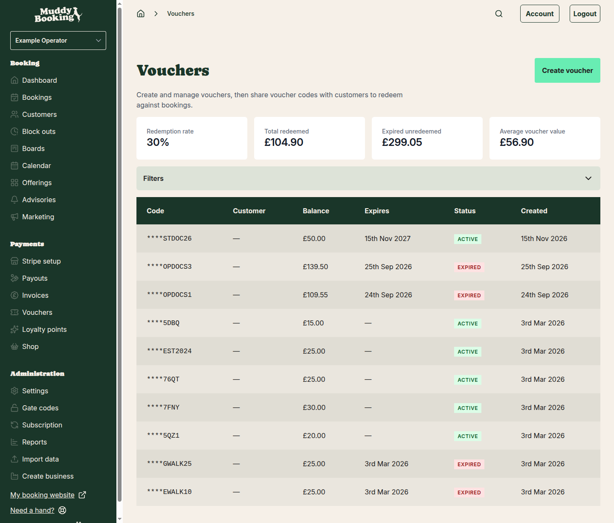

## Getting to vouchers

A voucher is credit a customer can spend on bookings. Use them for gift vouchers, promotions or refunds.

Click **Vouchers** in the left-hand menu.

The page shows your voucher statistics, such as redemption rates and total amounts, and a list of your vouchers.

## Creating a new voucher

Click **Create voucher** at the top of the page.

1. **Code** **(1)**: the code customers enter to use the voucher. Muddy fills in a random code for you. Use letters and numbers only, with no spaces or symbols. You can either:
   - Keep the random code, or click **Generate** **(2)** for a new one
   - Type your own, such as "WALK10" or "GIFT50". Make it hard to guess

2. **Customer** (optional): the customer the voucher belongs to. When they're logged in and book, the voucher is applied for them automatically.

3. **Initial balance** **(3)**: how much credit the voucher holds.

4. **Voucher has a start date** (optional): switch this on if the voucher can't be used until a set date, then choose it under **Valid from**.

5. **Voucher expires** **(4)**: switch this on if the voucher should expire, then choose the **Expiry date**. If you've set a default voucher expiry under **Settings** then **Vouchers**, this is switched on already with that date filled in.

6. Click **Create voucher** **(5)**.

## After creating a voucher

You'll be taken to the voucher's page.

It shows:
- The customer it belongs to, if you chose one
- The code, partly hidden with asterisks. Click the copy button next to it to copy the full code
- Where it came from, such as **Manual**, **Gift card order**, **Loyalty reward** or **Refund**, shown under **Origin**
- The current balance
- The status: **Active**, **Not yet valid**, **Expired** or **Spent**
- When it's valid from, and when it expires
- The date it was created
- Its transactions, starting with the initial credit
- Its deliveries, if you've sent it to anyone
- Notes you've added about it

## Managing existing vouchers

From the voucher's page you can:

- **Record transaction**: add credit (**Credit**) or take it away (**Debit**)
- **Edit voucher**: change the code, customer, start date or expiry date. You can't change the balance here. Use **Record transaction** instead
- **Send voucher**: [send the code to a customer](sending-vouchers-to-customers.md)
- **Expire voucher**: stop the voucher working straight away. You'll be asked to confirm

**Send voucher** and **Expire voucher** aren't shown once a voucher has expired. To bring an expired voucher back, click **Edit voucher** and change its expiry date.

## Voucher list view

The main vouchers page lists all your vouchers.

Each one shows its code, customer, balance, expiry date, status and creation date. Click a voucher to open it.

Use the filters above the list to find vouchers by **Code**, **Customer** or **Status**.

## Tips for voucher codes

- Pick codes that are easy for the customer to remember but hard for anyone else to guess
- You could include your business name or service, such as "DOGWALK25"
- Avoid sequences like "1234" and common words like "DISCOUNT"
- If you'd rather not think of one, keep the random code Muddy fills in

## How customers use vouchers

Customers enter the code when they book, or at checkout in your shop. If the voucher belongs to them, it's applied automatically when they book while logged in. The cost comes off the voucher's balance, and whatever's left can be spent later until it runs out or expires.

You can also take a payment from a voucher yourself. See [Paying for a booking or invoice from a voucher](paying-from-a-voucher.md).
