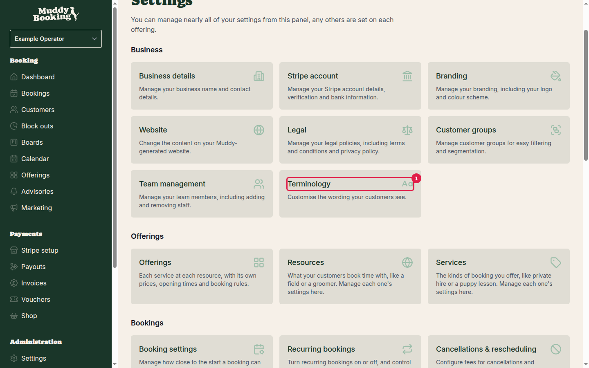
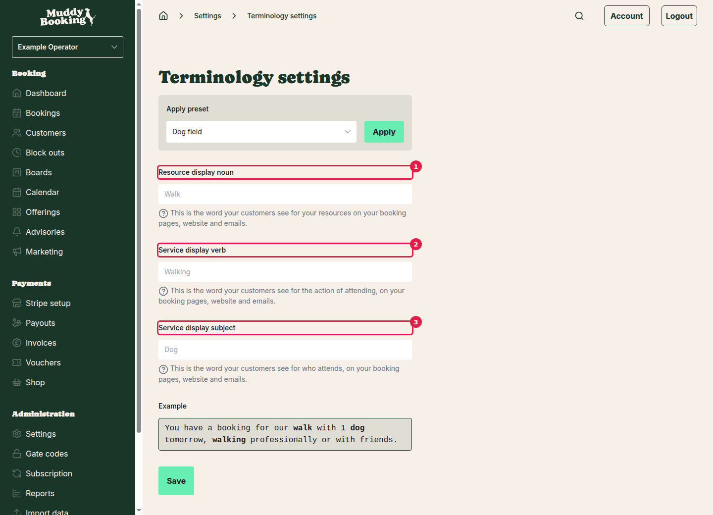
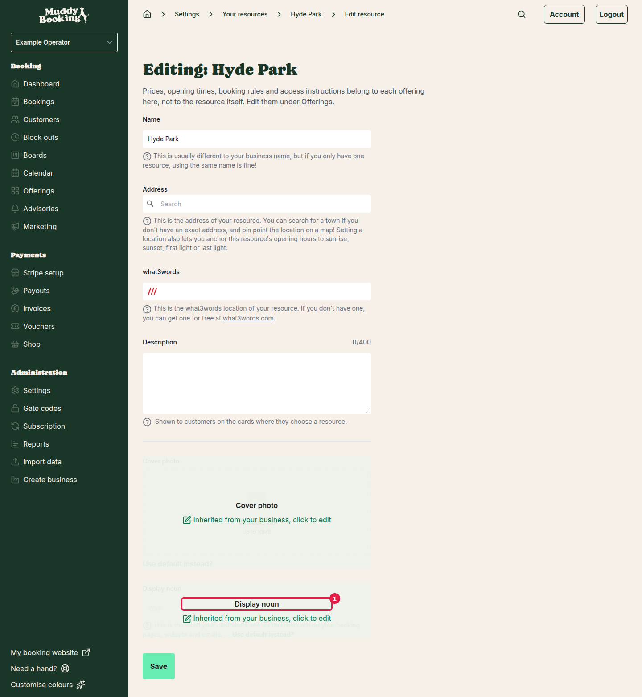
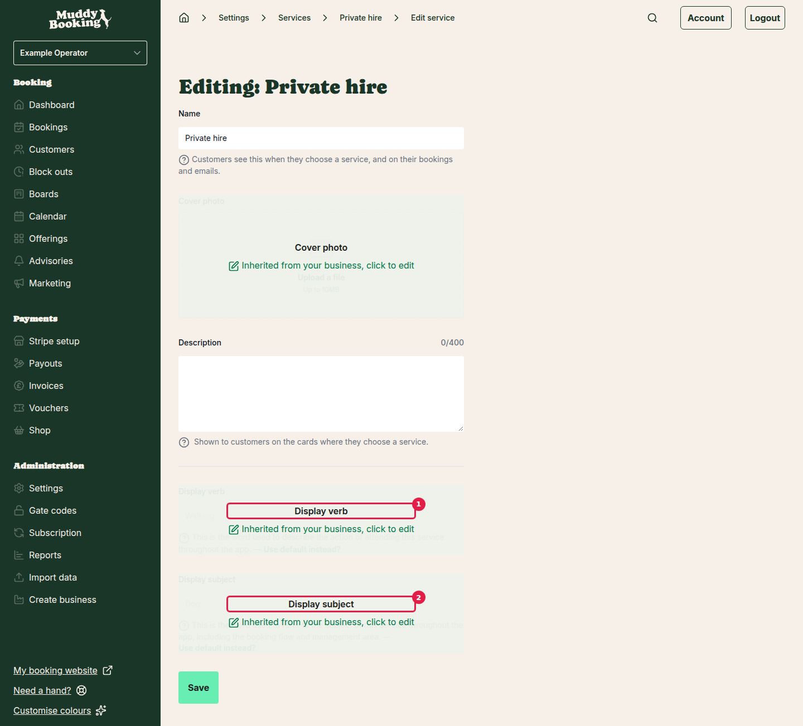

## Why customize terminology?

Muddy Booking was built for dog walking, but you might run training classes, grooming appointments or arena hire. Terminology settings change the words Muddy uses so they fit your business.

For example, you could call your resources "arenas" and the people who attend "riders". The new words appear in your booking form, customer messages and invoices.

## Getting to terminology settings

1. Click **Settings** in the left-hand menu.
2. Under the Business section, click **Terminology** **(1)**.

## Using preset terminology

Presets fill in the words for common business types:

- **Dog field**: field hire and other outdoor field activities
- **Dog training**: training sessions and classes
- **Dog grooming**: grooming appointments
- **Equine arena hire**: riding and arena bookings

To use one:

1. Click the **Apply preset** menu.
2. Choose your business type.
3. Click **Apply**.
4. Click **Save**.

## Setting your own terminology

To pick your own words, fill in the three fields:

**Resource display noun** **(1)** is the word for your resources. Customers see it when choosing where to book and on their confirmation emails. For example, "field", "arena", "park", "pool" or "suite".

**Service display verb** **(2)** is the action word for your service. For example, "walking", "training", "grooming", "riding" or "attending".

**Service display subject** **(3)** is the word for what gets booked. For example, "dog", "horse", "pet" or "rider".

These three words are your business-wide defaults. Every resource and service inherits them unless you set different words for a specific one (see [Per-resource and per-service words](#per-resource-and-per-service-words) below).

## Seeing your changes in action

The example sentence under the fields updates as you type, so you can check how your words read:

*"You have a booking for our [noun] with 1 [subject] tomorrow, [verb] professionally or with friends."*

## Saving your terminology

Click **Save** at the bottom of the page. The new words apply straight away across your booking form and emails.

## Per-resource and per-service words

Your three business-wide words are defaults. You can override them on individual resources and services when one location or service type needs different wording.

### Overriding the word for a resource

Each resource has its own **Display noun** field in its settings. For example, if most of your resources are "fields" but one is a "pool", you can set that one resource to use "pool" while everything else stays as "field".

To change it:

1. Go to **Settings** in the left-hand menu, then click **Resources** under Offerings.
2. Click the resource you want to change.
3. Click **Settings**, then choose **Settings** ("Name, details and photo") from the menu.
4. Scroll down to **Display noun** **(1)** and type the word for this resource.
5. Click **Save**.

The field shows **Inherited from your business, click to edit** when it is using the business default. To go back to the default after changing it, click **Use default instead?**.

### Overriding the words for a service

Each service has its own **Display verb** and **Display subject** fields. For example, if your main service uses "Walking" and "Dog" but you also run a training class, you could set that service to "Training" and "Handler".

To change them:

1. Go to **Settings** in the left-hand menu, then click **Services** under Offerings.
2. Click the service you want to change.
3. Click **Edit**.
4. Scroll down to **Display verb** **(1)** and **Display subject** **(2)**, and type the words for this service.
5. Click **Save**.

Both fields show **Inherited from your business, click to edit** when they are using the business default. Click **Use default instead?** to revert either one.

For a full guide to setting up resources and services, see [Setting up your offerings](creating-a-walk.md).

## Where terminology appears

- Customer booking forms
- Booking confirmations and reminders
- Your admin area (the service words only: the admin area always says "resource")
- [Invoice descriptions](invoicing-and-automatic-payments.md)
- [Email and SMS notifications](setting-up-whatsapp-sms-notifications.md)
- Calendar entries

## Tips for choosing terminology

- Use the words your customers already use.
- Check the example sentence before saving, and think about how the words will read in emails and on invoices.
- If you only have one resource or one service, you probably don't need per-resource or per-service overrides.

You can change your terminology at any time.
