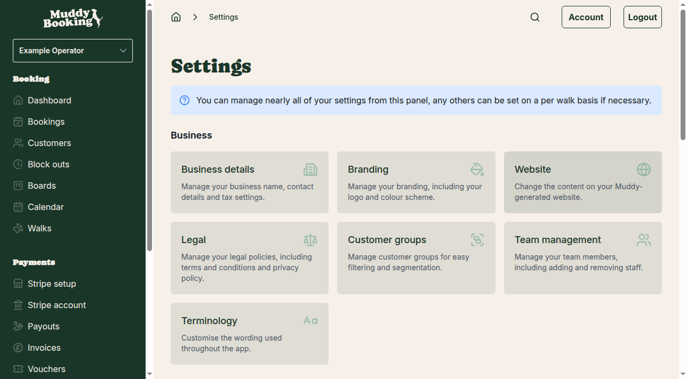
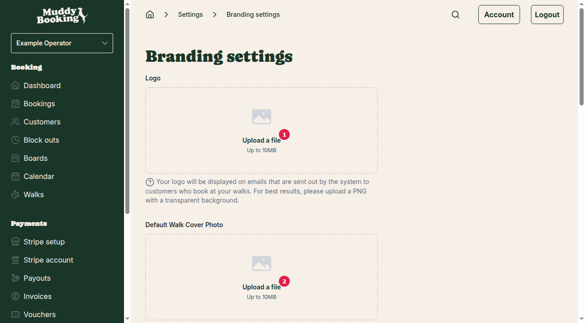
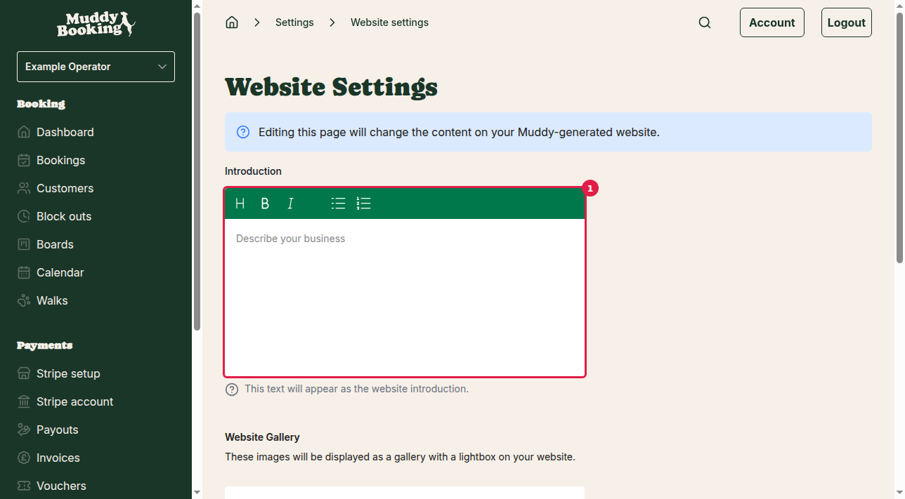
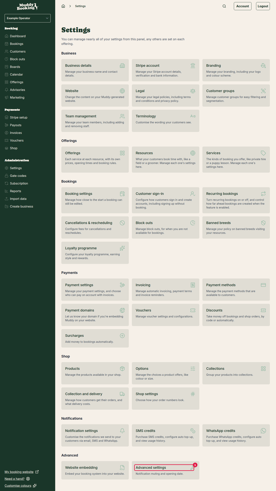
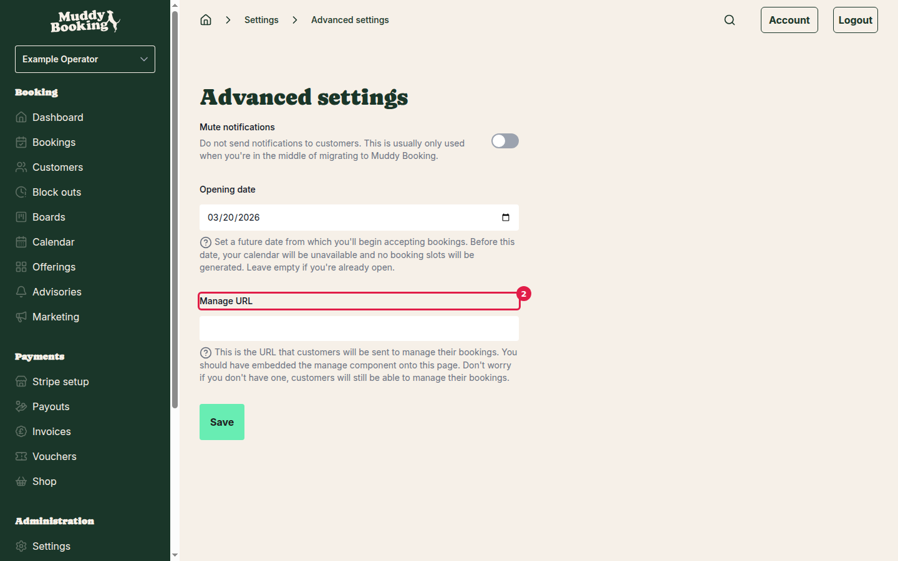

## Overview

You can add your logo, choose a colour palette, and fill your hosted booking website with an introduction, photos and social media links.

## Customizing your branding

Branding controls how your business looks in emails and across the booking system.

1. Click **Settings** in the left-hand menu
2. In the Business section, click **Branding**

### Uploading your logo

Your logo appears on the emails sent to customers who book with you, and at the top of your booking pages.

1. In the Logo section **(1)**, click **Upload a file**
2. Choose your logo file (up to 10MB)

A PNG with a transparent background looks best.

Once a logo is uploaded, **Logo size in emails** appears below it. Choose **Small**, **Medium**, **Large** or **Jumbo** to set how wide your logo shows at the top of emails.

### Setting a default cover photo

This photo is used for any resource or service that doesn't have its own cover photo, and at the top of your booking website.

1. In the Default cover photo section **(2)**, click **Upload a file**
2. Choose your image (up to 10MB)

**Show header image** controls whether the cover photo appears at the top of your website and booking forms, including forms embedded on your own website. Switching it off hides the photo but keeps it uploaded.

### Choosing your color palette

Your [colour palette](changing-system-colour-scheme.md) sets the colours of your booking forms and admin area.

1. In the Colour palette section **(3)**, choose one of:
   - **Custom**: pick your own brand colour and accent colour
   - **Muddy**: dark green and mint
   - **Frosty Paws**: navy and icy blue
   - **Pawsh Pink**: plum and pink
   - **Red Set Go!**: deep red and coral
   - **Pumpkin Pup**: orange and amber
   - **Bark Mode**: charcoal and mint
   - **Noble Paws**: charcoal, gold and teal
   - **Splashy Paws**: teal and pink

   A sample of your booking page under the palettes shows the colours before you save. If you've uploaded a logo, the Custom palette suggests colours from it. See [Building a custom palette](changing-system-colour-scheme.md#building-a-custom-palette).

2. Click **Save** **(4)**

## Customizing your hosted website

Your hosted website is where customers find out about you and book.

1. On the Settings page, click **Website** in the Business section

### Adding introduction text

This is the main introduction on your website.

1. In the Introduction section **(1)**, click in the **Describe your business** box
2. Write a short introduction covering:
   - What you offer
   - Your experience or qualifications
   - What sets you apart
   - The area you cover

### Creating a website gallery

Photos show customers what to expect and help them trust you.

1. In the Website Gallery section, click **Upload files** **(2)**
2. Choose your images (up to 10MB each), such as:
   - Happy dogs in your care
   - The places you walk
   - Your team at work
   - Before and after photos of muddy dogs

Customers can click through the photos on your website. Click a photo to add a description. Use the arrows on a photo to change the order, or the bin to remove it.

### Adding your website and social media links

1. If you have your own website, enter its full address in the **Website URL** field, for example **https://www.yourbusiness.com**
2. Under **Facebook page** **(3)**, click **Connect with Facebook**. Sign in to Facebook, then click **Choose** next to your business's page. You need to be an admin of the page for it to show up.
3. In the Instagram handle field **(4)**, enter your username without the @, which is already there. If your Instagram is @happydogwalker, enter **happydogwalker**
4. Click **Save**

To use a different Facebook page later, click **Clear** on the linked page and connect again.

## Managing booking URLs

If you've added Muddy's booking management to your own website, enter its address as the **Manage URL** in your advanced settings. Customers will be sent there to manage their bookings.

1. Click **Settings** in the left-hand menu
2. Scroll down to the **Advanced** section and click **Advanced settings** **(1)**

3. Enter the address of your booking management page in the **Manage URL** field **(2)**

4. Click **Save**

If you don't have your own website, customers manage their bookings on Muddy instead.

## Tips for effective branding

- Use a high-resolution logo with a transparent background so it looks right on any background
- Pick a colour palette that matches your existing branding
- Use clear, well-lit photos
- Write your introduction in a friendly tone, and answer what customers worry about most, such as safety and reliability

Branding changes show straight away on new bookings and in future emails.
