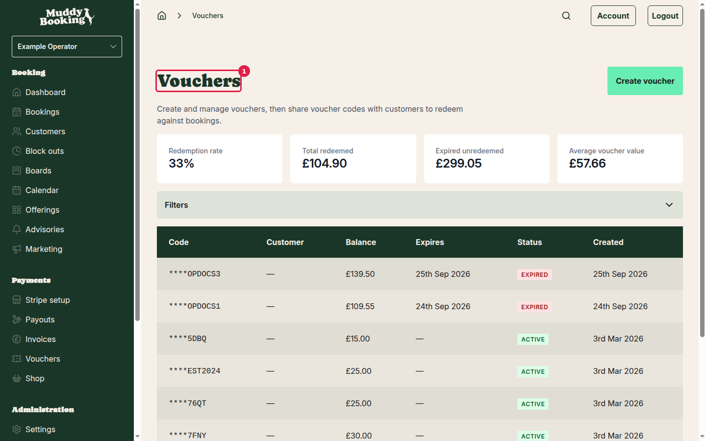
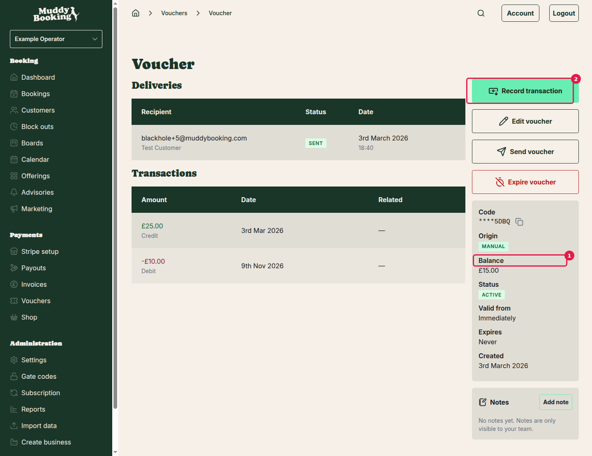
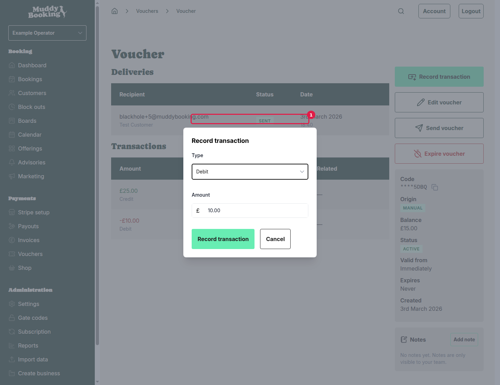

## How paying from a voucher works

When a customer wants to use their voucher to cover a booking or invoice, you record a **Debit** transaction directly on the voucher. This reduces the voucher balance by the amount owed.

You handle this entirely from the customer's voucher page, not from the booking or invoice itself.

## Step 1: Find the customer's voucher

Click **Vouchers** in the left-hand menu to open the vouchers list.

Find the voucher you want to use. Each row shows the current **Balance** and **Status**. Only **ACTIVE** vouchers with enough balance can be used for payment.

> **Check the balance first.** Make sure the voucher balance is at least as large as the amount you need to deduct before proceeding. You can see the balance in the vouchers list, or click the voucher to see it on its detail page.

Click the voucher code to open the voucher.

## Step 2: Check the balance on the voucher page

The voucher detail page shows the current **Balance** and **Status** prominently, along with a full history of past transactions.

Confirm that:

- The status is **ACTIVE**
- The balance is enough to cover the booking or invoice amount

## Step 3: Record the debit transaction

Click **Record transaction** **(2)** on the voucher page. A small form appears below.

Fill in the form:

- **Type**: select **Debit** (this reduces the voucher balance, recording the payment)
- **Amount**: enter the amount to deduct, matching what the customer owes for the booking or invoice

Click **Record transaction** to save.

The voucher balance updates immediately, and the debit appears in the **Transactions** history on the same page, showing the amount and date.

## Step 4: Mark the booking or invoice as paid

Recording a debit on the voucher does not automatically mark the related booking or invoice as paid. After recording the voucher debit, go to the booking or invoice and record the payment there too.

For an invoice, open it from the **Invoices** section and click **Record payment**. See [Invoicing and automatic payments](invoicing-and-automatic-payments.md) for details on how to do this.

---

## When a customer already paid by card but wants to switch to their voucher

If a customer paid by card and later wants to use their voucher balance instead, you need to:

1. Check the voucher has enough balance to cover the amount
2. Refund the card payment
3. Record a debit from the voucher

### Check the voucher balance

Before doing anything else, go to **Vouchers** in the left-hand menu and open the customer's voucher. Confirm the **Balance** is enough to cover the amount that was charged to the card. If it isn't, you cannot complete the switch.

### Refund the card payment

Go to **Invoices** in the left-hand menu (or find the booking) and open the relevant invoice or booking. Use the refund option to return the card payment to the customer.

> **Important:** A card refund is permanent and cannot be undone. Make sure you have confirmed the customer's intention and that the voucher has enough balance before proceeding.

Cancel out of the refund dialog if you are not ready to proceed, or continue if you are sure.

Once the refund is confirmed, the card payment is reversed and the invoice or booking is marked as unpaid again.

### Pay from the voucher

Now go back to the customer's voucher (via **Vouchers** in the left-hand menu), and follow the steps above to record a **Debit** transaction for the same amount. Then go back to the invoice or booking and record the payment there to mark it as paid.
