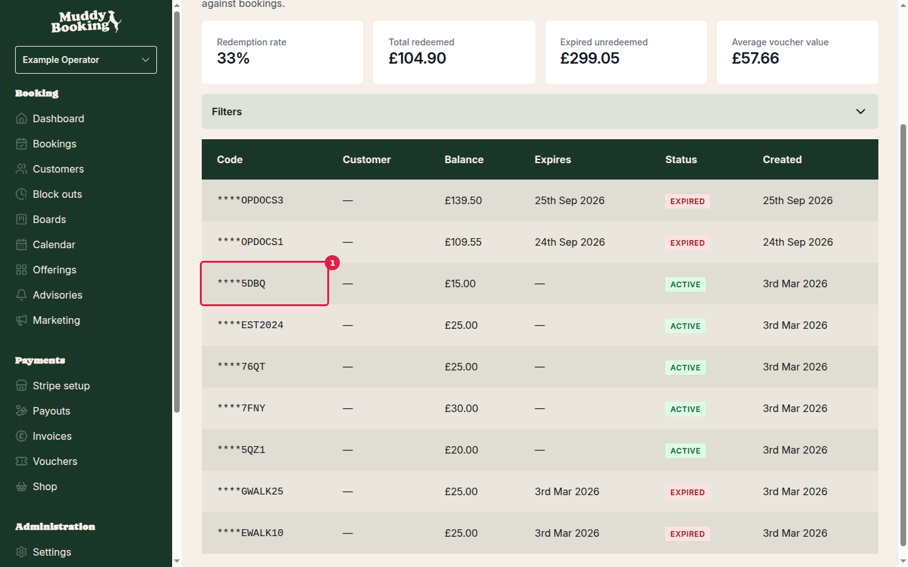
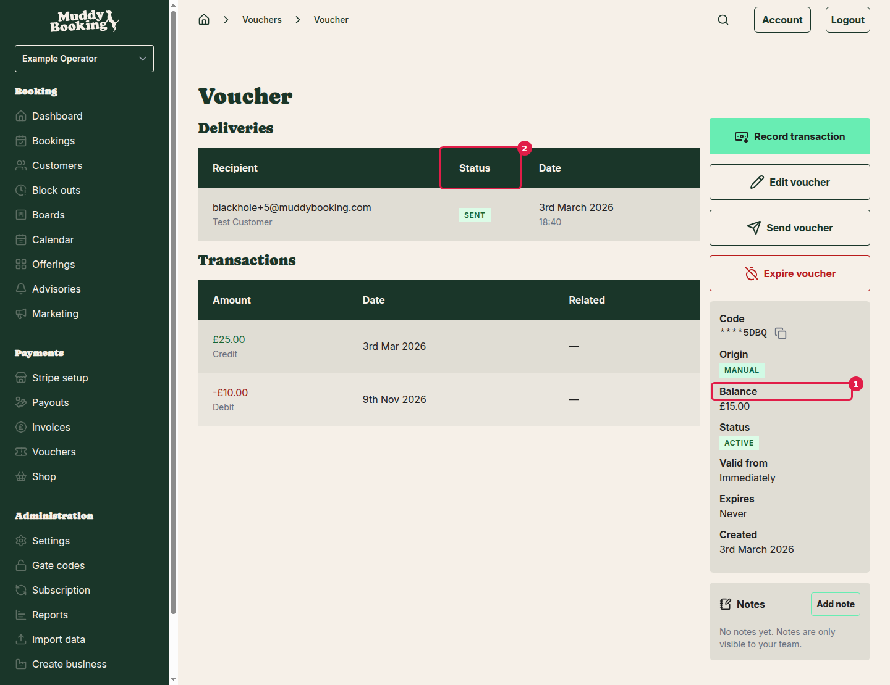

## How it works

When a customer wants to pay using their voucher, you record the payment directly on the booking or invoice. Muddy deducts the amount from the voucher balance automatically and marks the booking or invoice as paid.

Before you start, make sure the customer has an active voucher with enough balance to cover the amount owed. You can check this in **Vouchers** in the left-hand menu.

## Step 1: Check the voucher balance

Click **Vouchers** in the left-hand menu. The list shows each voucher's current **Balance** and **Status**.

Only vouchers with status **ACTIVE** can be used for payment. Click the voucher code to open the voucher and see the full details.

The voucher detail page shows the **Balance** and **Status** prominently. Confirm:

- The status is **ACTIVE**
- The balance is at least as large as the amount the customer owes

> If the voucher doesn't have enough balance, you can either top it up by clicking **Record transaction** and adding a Credit, or the customer will need to pay the remaining amount another way.

## Step 2: Open the booking or invoice

Go to the booking or invoice you want to mark as paid.

- For a booking, click **Bookings** in the left-hand menu and open the relevant booking.
- For an invoice, click **Invoices** in the left-hand menu and open the relevant invoice.

## Step 3: Record payment from the voucher

On the booking or invoice page, click **Record payment**.

A form appears. Fill it in:

- **Payment method**: select **Voucher**
- **Voucher code**: enter the customer's voucher code
- **Amount**: confirm or adjust the amount to deduct (it defaults to the full amount owed)

Click **Record payment** (or **Save**) to confirm. Muddy deducts the amount from the voucher balance and marks the booking or invoice as paid.

> The voucher's transaction history will show the debit alongside the booking or invoice reference, so you have a full record of what was paid and when.

---

## When a customer already paid by card but wants to switch to their voucher

If a customer paid by card and later wants to use their voucher balance instead, you need to do three things in order:

1. Check the voucher has enough balance
2. Refund the card payment
3. Record payment from the voucher

### Check the voucher balance first

Before doing anything else, go to **Vouchers** in the left-hand menu and open the customer's voucher. Confirm the **Balance** covers the full amount that was charged to card. If it doesn't, you won't be able to complete the switch.

### Refund the card payment

Open the booking or invoice. Find the existing card payment and click to refund it.

> **A card refund is permanent and cannot be undone.** Make sure the voucher has enough balance and that the customer wants to switch before you confirm.

A confirmation dialog will appear. If you're not ready, click **Cancel** to go back without refunding. When you're sure, confirm the refund. The card payment is reversed and the booking or invoice returns to unpaid.

### Record payment from the voucher

Once the refund is processed, the booking or invoice will show as unpaid again. Click **Record payment**, select **Voucher** as the payment method, enter the voucher code, and confirm. The amount is deducted from the voucher and the booking or invoice is marked as paid.

---

## Voucher refund policy

If a booking paid by voucher is later cancelled and refunded, you can control what happens to the refund. Go to **Settings**, scroll down to **Payments**, and click **Vouchers**.

Under **Voucher refund policy**, choose:

- **Refund to original voucher**: the amount goes back to the voucher the customer used to pay, even if it has since expired. If it has expired, the customer won't be able to use the balance until you manually extend the voucher.
- **Refund to new voucher**: a fresh voucher is created with the refunded amount.

See [Creating vouchers](creating-vouchers.md) for how to extend or manage existing vouchers, and [Sending vouchers to customers](sending-vouchers-to-customers.md) for how to share a new voucher with a customer.
