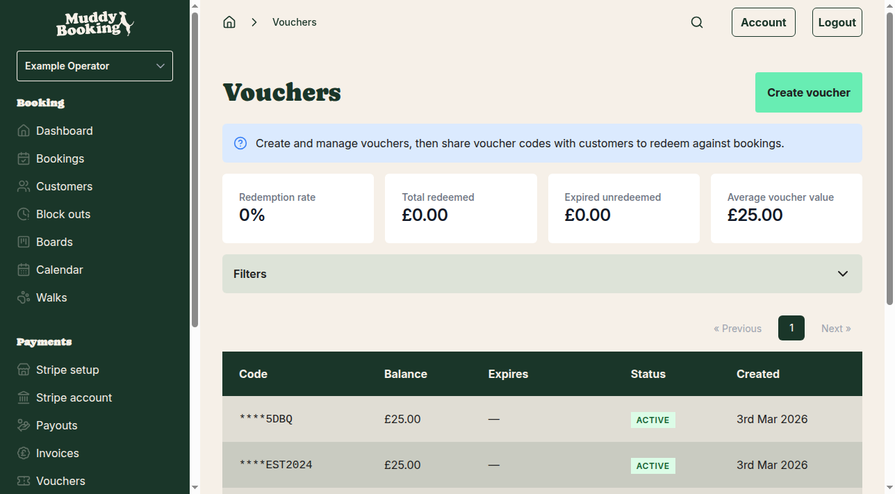
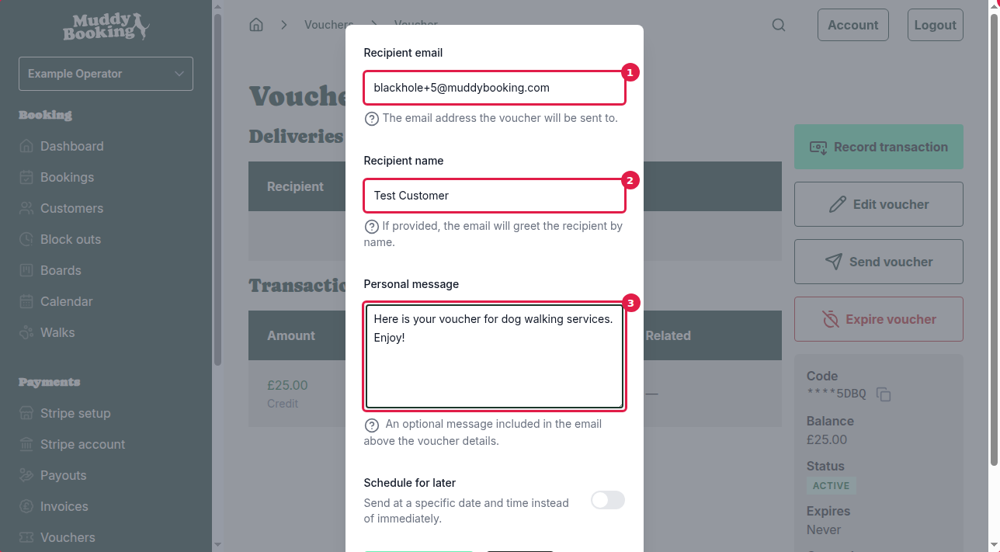
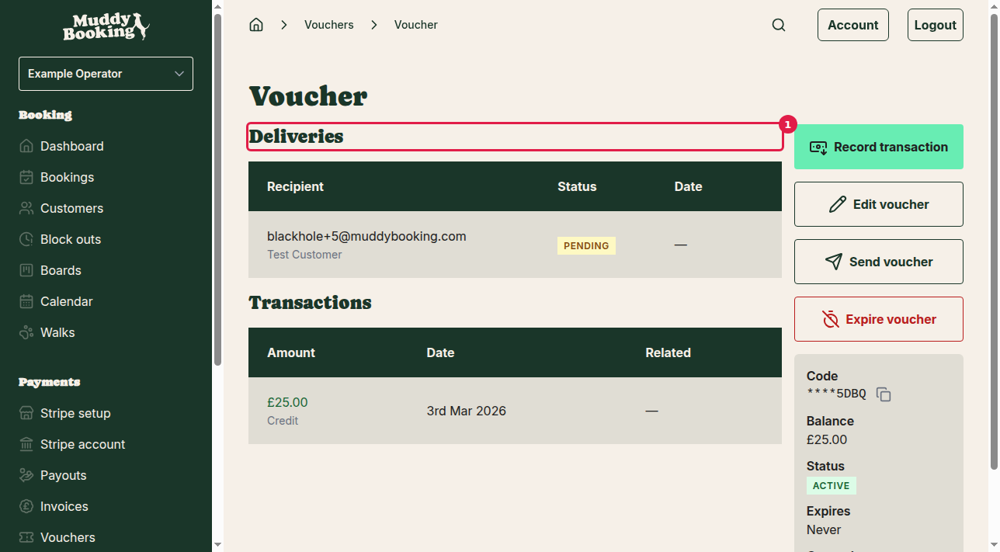

## Accessing the send voucher feature

Once you've [created a voucher](creating-vouchers.md), you can email it to a customer.

1. Go to **Vouchers** in the left-hand menu

2. Click the voucher you want to send
3. Click **Send voucher**

## Filling out the send voucher form

A pop-up appears:

- **Recipient email** **(1)** (required): where to send the voucher
- **Recipient name** **(2)** (optional): used in the email's greeting
- **Personal message** **(3)** (optional): shown above the voucher details in the email
- **Schedule for later** (optional): switch this on to send it later instead of now, then choose the date and time under **Send at**. The time is in your business's time zone

If you've sent the voucher before, the email and name are filled in from the last send. Otherwise they're filled in from the voucher's customer, if it has one.

## Sending the voucher

1. Enter the customer's email in **Recipient email**
2. Add their name or a message if you like
3. Click **Send voucher** **(4)**

You can't send a voucher that has expired. The **Send voucher** button isn't shown on an expired voucher.

## After sending

You'll be back on the voucher's page.

The **Deliveries** section **(1)** lists the email with:
- The recipient's email and name
- Its status, which starts as **Pending** and changes to **Sent**, or **Failed** if the email couldn't be sent
- When it was sent, or when it's scheduled to go

## Changing or cancelling a scheduled send

While a scheduled send is still **Pending**, you can change it:

- To edit it, click it in the **Deliveries** list. Change the recipient, message or **Send at** time, then click **Save changes**. To send it straight away instead, switch off **Schedule for later** and click **Send now**
- To cancel it, click the bin icon on its row, then click **Cancel it**

## Important notes

- You can send the same voucher to several people. Each gets their own email, but they all share the same code and balance
- Anyone with the code can use the voucher while it's **Active**
- Every send is listed in the voucher's Deliveries section
