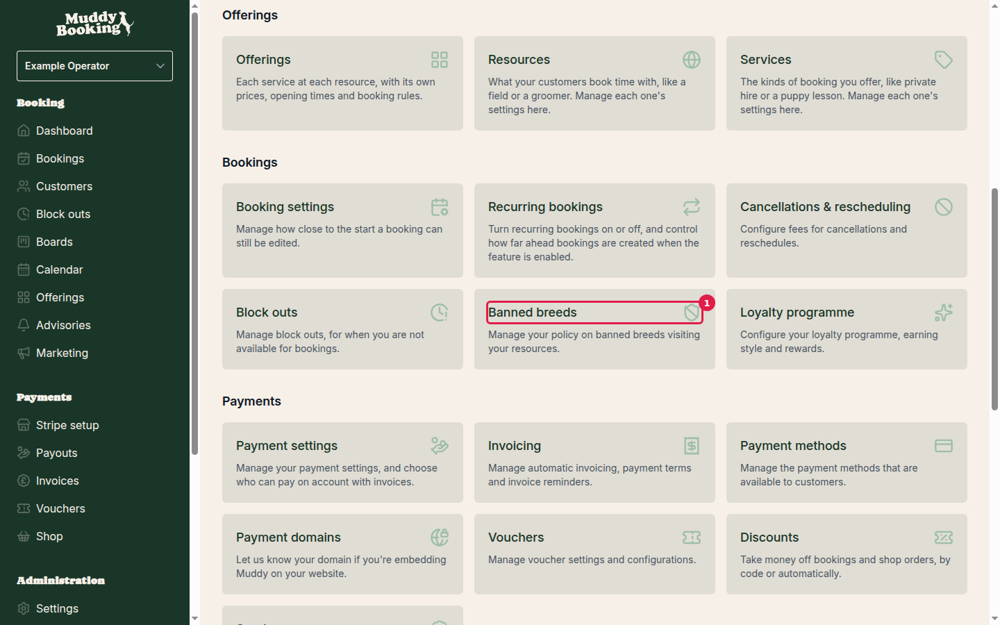
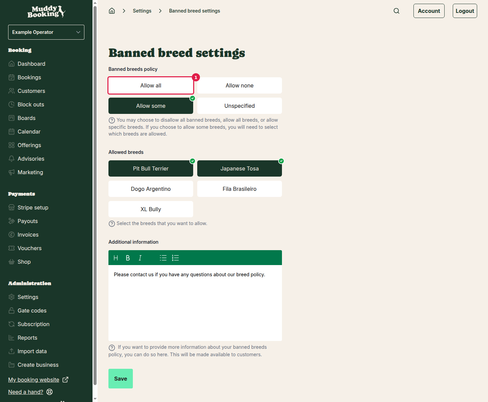
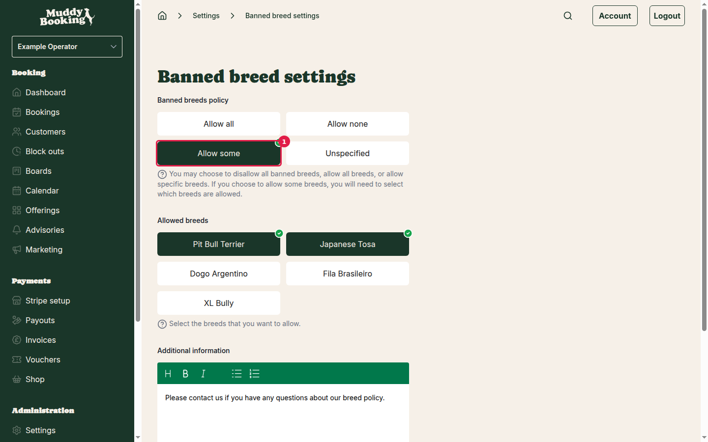
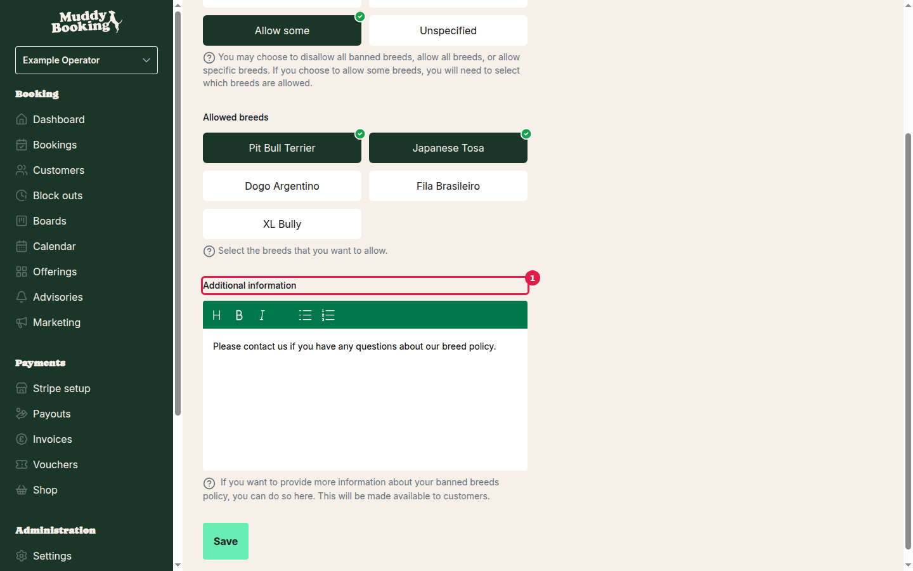

## Accessing banned breeds settings

1. Go to **Settings** in the left-hand menu.
2. Scroll down to the **Bookings** section.
3. Click **Banned breeds** **(1)**.

## Understanding the policy options

There are four options:

### Allow all
You accept every breed. No breed restrictions apply to bookings.

### Allow none
You don't accept any of the commonly banned breeds.

### Allow some
You accept some of the commonly banned breeds and choose which ones.

### Unspecified
You don't set a policy in Muddy.

## Setting up selective breed acceptance

Select **Allow some** **(1)** to reveal the list of breeds you can choose from:

- Pit Bull Terrier
- Japanese Tosa
- Dogo Argentino
- Fila Brasileiro
- XL Bully

Tick each breed you're happy to accept bookings for.

## Adding additional information

You can add a note to explain your policy to customers:

1. Scroll down to **Additional information** **(1)**.
2. Enter the details you want customers to see.

You might include:
- Why you have the policy
- How to contact you with questions
- Any exceptions you make
- Alternative services you offer

## Saving your settings

Click **Save**. You'll return to the Settings page and your policy applies straight away.

## Important considerations

- The policy applies to all your resources and bookings.
- Customers see the policy when they book. To make them accept it before booking, see [Setting up legal documents](setting-up-legal-documents.md#requiring-customer-acceptance-5).
- Check your insurance and local regulations when choosing your policy.
- You can change the policy at any time.
