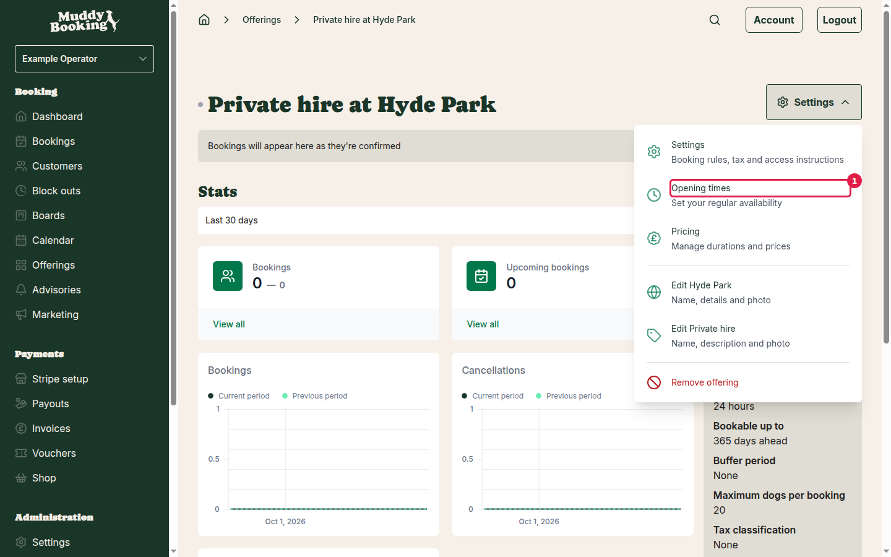
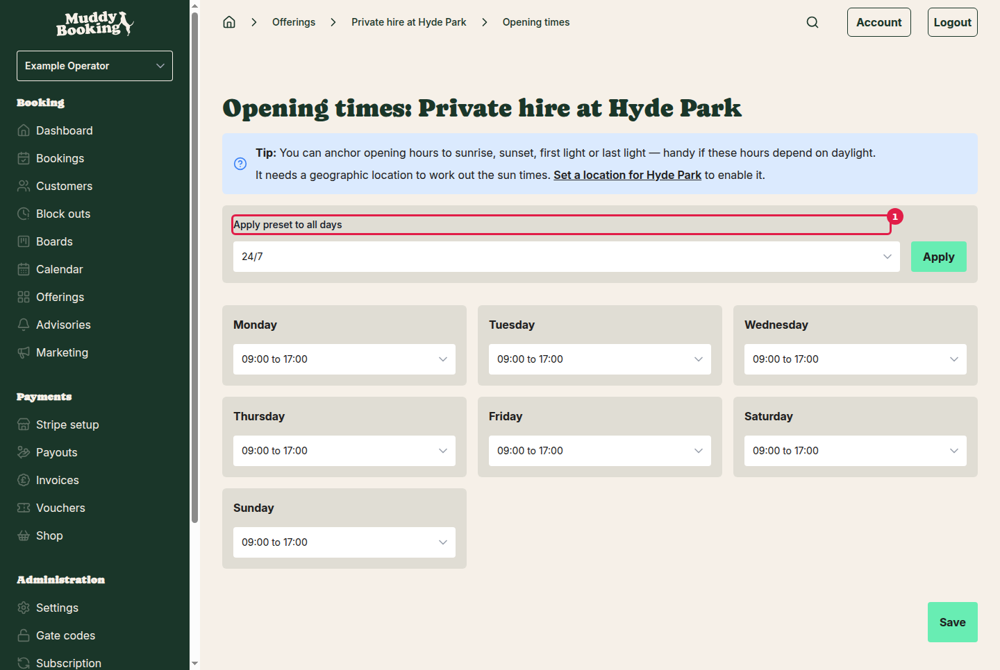

## What are opening times?

Opening times are the hours customers can book. You set them separately for each offering, so different services or locations can have different hours.

For one-off closures such as holidays, see [How to add a block out](adding-block-outs.md).

If you haven't set up your offerings yet, start with [Setting up your offerings](creating-a-walk.md).

## Setting opening times for an offering

1. Click **Offerings** in the left-hand menu
2. Click the offering you want to set hours for
3. Click **Settings**
4. Click **Opening times**

You'll see a row for each day of the week. Set each day to the hours that offering is available.

### Using preset times for all days

To set every day at once:

1. Choose a preset from the **Apply preset to all days** menu at the top of the page, such as **24/7**, **09:00 to 17:00**, **08:00 to 20:00** or **Closed**
2. Click **Apply**

### Setting individual days

For each day, choose one of:

- **24/7**: open all day
- A set range, such as **05:00 to 22:00**, **06:00 to 20:00** or **09:00 to 17:00**
- **Closed**: no bookings that day
- **Custom**: enter your own start and end times

Click **Save** at the bottom of the page.

### Anchoring to sunrise or sunset

If your hours follow daylight, for example you always open at sunrise or close before dusk, you can anchor times to sunrise, sunset, first light or last light instead of fixed clock times. This requires a geographic location to be set on the resource. Add the location in the resource's settings, and the option will appear on the opening times page.

## Setting times for multiple offerings

Each offering has its own opening times, so repeat the steps above for each one. This lets you, for example, run one service only on weekdays and another at weekends.

## Tips

- **Set opening times before you go live**: an offering without opening times cannot be booked by customers.
- **Use Closed** for days an offering is never available, even if your business is open on those days.
- **Changes apply straight away** to new bookings.
